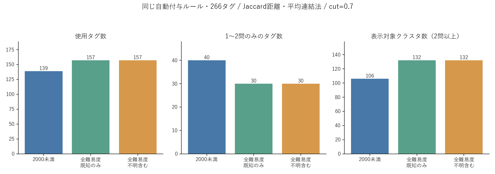

# 背景説明由来の誤付与修正と難易度範囲の比較

作成日：2026-11-05。ABC全3,012問・481コンテスト、タグ候補266種類を使用。

## 結果

同じ自動付与ルールでは、2000未満で139種類、全難易度で157種類のタグを観測した。1〜2問しか付かないタグは40種類から30種類になった。問題範囲の拡張により観測は増えたが、タグの粒度やクラスタの意味がそろったとは判断できない。

| 指標 | 2000未満 | 全難易度（既知のみ） | 全難易度（不明含む） |
|---|---:|---:|---:|
| 対象問題 | 2,473 | 2,989 | 3,012 |
| 1種類以上のタグが付いた問題 | 1,693 | 2,179 | 2,189 |
| 自動では付与できなかった問題 | 780 | 810 | 823 |
| 問題–タグ対応 | 3,670 | 5,078 | 5,089 |
| 観測されたタグ | 139 | 157 | 157 |
| 未使用タグ | 127 | 109 | 109 |
| 1〜2問のみのタグ | 40 | 30 | 30 |
| 3問以上のタグ | 99 | 127 | 127 |
| cut=0.7のクラスタ | 127 | 148 | 148 |
| 2問以上を含む表示対象クラスタ | 106 | 132 | 132 |
| 複数タグをまとめたクラスタ | 11 | 8 | 8 |

未付与は「該当するアルゴリズムがない」という意味ではない。単純な算術や条件分岐に対応するタグの不足、暗黙の解法、解説取得・抽出の不足、ルールの拾い漏れが含まれる。

## 比較で固定した条件

- タグ語彙266種類、問題文・解説の凍結スナップショット、名前・説明・コードの検出ルール、背景節の除外条件を固定した。
- 全3,012問を一度だけ自動付与し、その行列から2000未満を抽出した。同じ問題の266列の値が両条件で完全一致することを確認した。
- 主比較には旧898問の引継ぎタグも27問の個別AIレビューも使っていない。難易度帯による手修正の偏りを抑えるためである。
- クラスタリングは問題集合のJaccard距離、平均連結法、distance cut=0.7。0件タグをクラスタリングから除外し、各条件で観測されたタグだけを使った。
- 表示対象はクラスタ内の問題IDの和集合が2問以上のもの。タグごとの件数を単純に足していない。
- 難易度不明23問は2000未満に含めず、全難易度には含めた。既知のみ2,989問の結果も併記した。
- 未付与問題の行は保存したが、全0行はJaccard距離の交差・和集合を変えない。問題数が増えただけでは距離は変わらない。

## 修正内容

アッカーマン関数8対応とMontgomery法5対応について、背景説明・他問題の節からの誤付与を削除した。アッカーマン関数はUnion-Findの計算量に登場する逆関数の説明であり、その問題で関数を計算する解法ではなかった。Montgomery法はABC262の複数問題に同じ総合解説が紐付いたことに由来していた。

ABC222 Hの説明用のカタラン数の例題、ABC370 Gの計算量評価での素数定理、ABC476 Gの参考記事名のSpernerの定理という3対応も、原文を点検して除外した。ABC476 Gで上界の証明に実際に使っているLYM不等式は残した。

加えて、次の出典・根拠を保守的に扱うようにした。

- 同じURL・同じ本文が複数問題に丸ごと紐付いた解説を、問題ごとの範囲を確認するまで自動付与から隔離する。PDFは冒頭の問題名が対象のタイトルと完全一致する場合だけその対象で利用する。
- 「この問題の解説」の前にまとまった前提説明がある文書は、実際の問題解説部分を使う。ABC265 HのOR/AND畳み込みの他問題例を拾わず、実際の節にあるXOR畳み込みとFFTは保持した。
- 例題から元の問題に戻る区切りや参考文献・関連問題の節を除外する。
- 不可能・時間不足を述べる節を負例として扱う。同じ文の「全探索では間に合わないため二分探索を使う」では、後半の二分探索を残す。
- コードはC++等のmain内、Pythonのトップレベルとそこから呼ぶ関数に検出範囲を限定する。未使用ライブラリ・定義だけの断片を唯一の根拠にしない。
- タイトルだけに現れる名前を、解法を使った根拠にしない。

旧版との修正前後比較には、引継ぎ・個別AIレビューを双方で同じように含む補助データを別途作成した。156問で対応が変わり、削除289対応・追加21対応、対応総数は5813→5545になった。

**削除件数すべてを「確認済みの誤付与」とは数えていない。** 出典・コードの範囲を保守的に限定したため、実行可能な別解を保留したものや補助技法の拾い漏れもあり得る。旧タグの引継ぎ自体も全件検証済みではない。修正前後の差分は [correction_audit.csv](correction_audit.csv)、根拠の除外は各出力フォルダーの rejected_evidence.csv / source_scope_audit.csv に記録した。

## 高難易度で初めて観測したタグ

| タグ | 2000未満 | 2000以上 | 不明 |
|---|---:|---:|---:|
| T024 挿入DP | 0 | 1 | 0 |
| T035 燃やす埋める | 0 | 3 | 0 |
| T038 ミニマックス法 | 0 | 1 | 0 |
| T048 オイラー路 | 0 | 3 | 0 |
| T057 行列木定理 / Kirchhoff の定理 | 0 | 3 | 0 |
| T098 Euler の totient 関数 | 0 | 3 | 0 |
| T101 LYM 不等式 | 0 | 1 | 0 |
| T107 Walsh-Hadamard 変換 | 0 | 2 | 0 |
| T108 XOR 畳み込み | 0 | 2 | 0 |
| T124 原始根 | 0 | 2 | 0 |
| T138 転置原理 | 0 | 1 | 0 |
| T139 辺彩色 | 0 | 1 | 0 |
| T173 割当問題 / ハンガリアン法 | 0 | 1 | 0 |
| T179 Burnside の補題 / Pólya 数え上げ | 0 | 2 | 0 |
| T189 離散対数 | 0 | 2 | 0 |
| T216 直線の交点 | 0 | 4 | 0 |
| T243 KMP 法 | 0 | 4 | 0 |
| T255 Suffix Automaton | 0 | 1 | 0 |

これらは現ルールでの観測候補であり、全件の正付与を保証するものではない。少数例では、誤付与1件の影響も大きい。

## 共通タグのまとまりは変わったか

両条件で観測された共通139タグで比較すると、クラスタ分割のARIは0.608だった。ARIはラベル番号によらず分割の一致を測り、1は同一を示す。共通タグだけを両条件で再クラスタリングした場合のARIは0.608だった。

2000未満で同じクラスタだったタグ対13組のうち、全難易度でも同じだったものは7組。分離は6組、新しく同じクラスタになったものは3組。共通タグ間のJaccard距離の平均絶対変化は0.0028だった。

樹形図の上位には距離1.0の同率結合が多い。共通の付与問題を持たないタグ対は距離1となり、そこでの結合順序・左右の配置に意味を読み取らない。上位図と、拡大可能な全体SVGを併用する。

この一致度は正しさの評価ではない。単独タグのクラスタが多数あり、ARIだけでは少数の結合・分離の内容が分かりにくいため、具体的な変化を [common_tag_cluster_changes.csv](common_tag_cluster_changes.csv) で併せて確認する。

## 問題数と難易度の影響を切り分ける補助比較

全難易度の既知2,989問から、2000未満と同じ2,473問を非復元抽出した（乱数seed 0〜29、30回）。観測タグ数は平均153.6種類、範囲150〜157種類。2000未満の139種類と比べられる。

3問以上のタグは平均118.8種類（113〜123）。各標本に2000以上の問題を平均426.8問含む。

これは同じ問題数での構成比較であり、無作為実験・精度検証ではない。全体の増加を単純に「問題数が増えた効果」だけと解釈できないことを確認するための補助資料である。

## 残る制約

| 難易度帯 | 問題数 | タグ付与済み | 付与率 | 元の解説あり | 総合解説の隔離に影響された問題 |
|---|---:|---:|---:|---:|---:|
| 2000未満 | 2473 | 1693 | 68.5% | 2405 | 58 |
| 2000以上 | 516 | 486 | 94.2% | 516 | 0 |
| 難易度不明 | 23 | 10 | 43.5% | 23 | 0 |

難易度帯で付与率や解説の入手状況が異なる。自動付与は簡単な問題で技法名を拾いにくく、高難易度ほど名前付き技法が説明されやすい可能性がある。また、出典には既存チーム収集分、公式Web、ユーザー解説、PDFが混在し、解説件数・品質・PDFの抽出精度は一定ではない。同じルールを使っても、これらの偏りは残る。

語彙には、アルゴリズム・データ構造・数学的概念・上位分類が混在する。問題数の拡張だけで粒度はそろわず、Jaccardの共起も学習単位としての同義を保証しない。全件の主解・別解・補助の判定と独立した人手評価は未実施。

次は、新しく観測したタグと少数例のタグを優先して人手で確認し、主解・実行可能な別解・補助・背景の役割を分けるとよい。クラスタは候補として扱い、可視化用のタグ数を決める根拠にこの実験だけを使わない。

## データ・図・再実行

- [全266タグの件数比較](tag_support_comparison.csv)
- [比較条件・集計値・入力ハッシュ](comparison_summary.json)
- [2000未満のクラスタ内訳](under_2000/cluster_members.csv)
- [全難易度のクラスタ内訳](all_difficulties/cluster_members.csv)
- [2000未満の全体樹形図（SVG・拡大可）](under_2000_dendrogram.svg)
- [全難易度の全体樹形図（SVG・拡大可）](all_difficulties_dendrogram.svg)
- [2000未満の上位結合](under_2000_upper_tree.png) / [全難易度の上位結合](all_difficulties_upper_tree.png)
- [結果一式ZIP](comparison_results.zip)

全問題の解説本文を含む corpus_sources.jsonl はローカルに保存し、ZIPには含めていない。ZIP単体で元のタグ付与を再実行するには、この凍結入力とmanifest.json等が別途必要。ZIPには比較に使った行列、結果、修正ルール、検証コードを収録した。

旧 output/ と従来の898問用データは保存。修正版の引継ぎありデータは ../output_v2/、主比較用の統一自動付与データは ../output_v2_uniform/。主比較と補助データのタグ数は混同しない。

再実行（abc_allディレクトリ、既存仮想環境で実行）：

~~~powershell
..\.venv-clustering\Scripts\python.exe -X utf8 tag_all.py --uniform --output-dir output_v2_uniform
..\.venv-clustering\Scripts\python.exe -X utf8 tag_all.py --output-dir output_v2
..\.venv-clustering\Scripts\python.exe -X utf8 verify_dataset.py output_v2_uniform
..\.venv-clustering\Scripts\python.exe -X utf8 verify_dataset.py output_v2
..\.venv-clustering\Scripts\python.exe -X utf8 compare_difficulty.py
..\.venv-clustering\Scripts\python.exe -X utf8 verify_comparison.py
~~~

外部AI APIは利用していない。追加API費用0円。アプリケーションへの反映はこの比較には含めていない。
