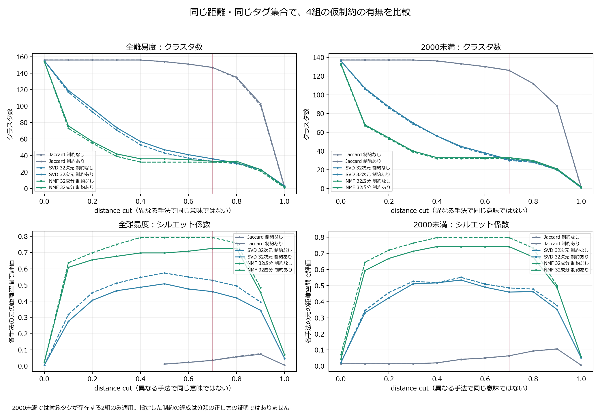

# 制約付き階層クラスタリングの比較実験

作成日：2026-11-19

## 目的と結論

SVD・NMFで見られた意味の異なるタグの混在に対して、少数の「同じ群に入れない」制約を追加した。直前のNMFに加え、SVD・Jaccardにも同じ制約を適用し、元の距離を変えずに制約あり／なしを比較した。

**指定した組合せの同居は防げた。ただし、そのタグが別の不適切な群へ移る例もあり、4組の制約だけで学習単位の粒度がそろったとはいえない。**

全難易度のNMFではcut=0.7で32群→33群、シルエット係数は0.793→0.726になった。この低下だけで失敗とも判断できない。元の距離で極めて近かったペアを人の仮説に従って分離したため、距離に対する凝集度は下がり得る。独立した人の評価による妥当性確認は未実施。

## 入力と比較条件

- 2026-11-05時点の同じ問題・タグ対応を使用。今回の処理では問題収集・タグ付与を変更していない。
- 全難易度：3,012問、比較対象156タグ。2000未満：2,473問、比較対象138タグ。
- SVD・NMFの比較条件に合わせ、共起のない文字列処理（T073）1タグは別枠。未使用タグも対象外。1問だけのタグは除外しない。
- Jaccard距離、SVD 32次元のコサイン距離、NMF 32成分のコサイン距離を前回の保存結果から読み込み、再学習していない。32は比較用の既定値であり最適値ではない。
- 同じ手法内の制約あり／なしでは、対象タグ・距離・平均連結法・同距離時の決定規則を共通にした。
- cut=0.0〜1.0を0.1刻みで比較。表示例は0.7・0.8・0.9。手法をまたいだ同一cutやシルエット係数は、そのまま分類精度の比較にはならない。
- 全難易度では4組を適用。2000未満はSuffix Automatonと離散対数が比較対象に存在しないため、CL02・CL04をスキップし2組を適用。存在しないタグを追加してはいない。

## 今回の仮制約

**ユーザーから個別の組合せ指定がなかったため、過去の結果で気になった例を元に作成した暫定案。statusはprovisional_assistantであり、人が承認済みの正解ラベルではない。**

| ID | 同じ群に入れないタグ | 仮説の理由 |
|---|---|---|
| CL01 | 連分数 ／ Bellman-Ford 法 | 数学の表現・数論技法と最短路アルゴリズムを同一の学習単位にしない仮説 |
| CL02 | 後退解析 ／ Suffix Automaton | 解析の考え方と文字列データ構造を同一の学習単位にしない仮説 |
| CL03 | 2-SAT ／ 木の塗り分け | 充足可能性への帰着と木の彩色を同一の学習単位にしない仮説 |
| CL04 | Map / 連想配列 ／ 離散対数 | 汎用データ構造と数論上の課題を同一の学習単位にしない仮説 |

[編集する制約CSV](constraints.csv) ／ [この実行に使ったスナップショット](constraints_used.csv)

今回はcannot-linkのみを使用し、must-linkは0件とした。「関連する」ことだけで同じ学習単位に強制的にまとめると、粒度をそろえる目的とずれるため。実装自体はmust-linkにも対応している。

## 計算方法

1. must-linkがあれば、その推移的なまとまりを最初に縮約する。図での高さ0は強制結合の表記上の約束で、元の距離0を意味しない。
2. 2つの群の距離は、元のタグ間距離の全組合せの平均とする。群サイズで重みを付けるUPGMAであり、群間距離を単純に半分ずつ平均する方法ではない。
3. cannot-linkのペアを含む群同士は結合候補から外す。別のタグを介した間接的な同居も禁止する。
4. 残った候補のうち距離が最小の2群を結合する。全候補が禁止されたら停止し、複数の木をそのまま出力する。

**禁止ペアの距離を単に1へ置き換える方法ではない。** 平均連結では他の距離との平均により後で同居し得るため、ここでは結合の可否を別に管理して全階層で制約を守る。

今回はすべての距離手法で最終的に2本の木になった。これは「最適な分野数が2」という意味ではなく、貪欲な結合の過程でそれ以上結合できなくなった結果。禁止制約を持つ以上、全体を1群にすることはできず、cut=1で必ず1群にはならない。

制約付き階層クラスタリングには複数の定式化がある。本実装はこの節で説明した、全階層で制約を守る単純な貪欲平均連結法であり、制約付き最適化の大域的な最適解を保証するものではない。must-link/cannot-linkと結合不能状態については、[Davidson・Raviの原著論文](https://web.cs.ucdavis.edu/~davidson/Publications/Pub2.pdf)を参照。

## cut=0.7の結果

| データ | 距離 | 群数：なし→あり | シルエット：なし→あり | 指定制約への違反：なし→あり |
|---|---|---:|---:|---:|
| 全難易度 | Jaccard | 147 → 147 | 0.035 → 0.035 | 0 → 0 |
| 全難易度 | SVD 32次元 | 33 → 36 | 0.529 → 0.459 | 4 → 0 |
| 全難易度 | NMF 32成分 | 32 → 33 | 0.793 → 0.726 | 4 → 0 |
| 2000未満 | Jaccard | 126 → 126 | 0.064 → 0.064 | 0 → 0 |
| 2000未満 | SVD 32次元 | 30 → 31 | 0.485 → 0.460 | 1 → 0 |
| 2000未満 | NMF 32成分 | 32 → 33 | 0.798 → 0.742 | 1 → 0 |

※ 群数に別枠の文字列処理1タグを含めていない。制約達成数は入力した条件への適合確認であり、分類精度ではない。

前回のSciPy版と今回の独自実装の制約なしcut=0.7の所属は、全6条件でARI=1.0と一致した。ARIは所属の一致を比べる値であり、正解率ではない。

木が複数に分かれると木をまたぐコーフェネティック距離が定義できないため、全体のコーフェネティック相関係数は計算していない。架空の根や距離を足して前回と比較することもしない。



## 画像とクラスタ内訳

タグ名は左、距離は右に向かって増加する。黒点が各木の根で、異なる木を結ぶ架空の枝は描いていない。枝色はcutによる群の目印で、分野名を表さない。

| データ・手法 | cut=0.7 | cut=0.8 | cut=0.9 |
|---|---|---|---|
| 全難易度・Jaccard | 147群 [画像](all_difficulties/jaccard/constrained_cut_0.7.png)・[内訳](all_difficulties/jaccard/constrained_clusters_cut_0.7.md)・[CSV](all_difficulties/jaccard/constrained_members_cut_0.7.csv) | 135群 [画像](all_difficulties/jaccard/constrained_cut_0.8.png)・[内訳](all_difficulties/jaccard/constrained_clusters_cut_0.8.md)・[CSV](all_difficulties/jaccard/constrained_members_cut_0.8.csv) | 103群 [画像](all_difficulties/jaccard/constrained_cut_0.9.png)・[内訳](all_difficulties/jaccard/constrained_clusters_cut_0.9.md)・[CSV](all_difficulties/jaccard/constrained_members_cut_0.9.csv) |
| 全難易度・SVD 32次元 | 36群 [画像](all_difficulties/svd_32/constrained_cut_0.7.png)・[内訳](all_difficulties/svd_32/constrained_clusters_cut_0.7.md)・[CSV](all_difficulties/svd_32/constrained_members_cut_0.7.csv) | 31群 [画像](all_difficulties/svd_32/constrained_cut_0.8.png)・[内訳](all_difficulties/svd_32/constrained_clusters_cut_0.8.md)・[CSV](all_difficulties/svd_32/constrained_members_cut_0.8.csv) | 23群 [画像](all_difficulties/svd_32/constrained_cut_0.9.png)・[内訳](all_difficulties/svd_32/constrained_clusters_cut_0.9.md)・[CSV](all_difficulties/svd_32/constrained_members_cut_0.9.csv) |
| 全難易度・NMF 32成分 | 33群 [画像](all_difficulties/nmf_32/constrained_cut_0.7.png)・[内訳](all_difficulties/nmf_32/constrained_clusters_cut_0.7.md)・[CSV](all_difficulties/nmf_32/constrained_members_cut_0.7.csv) | 33群 [画像](all_difficulties/nmf_32/constrained_cut_0.8.png)・[内訳](all_difficulties/nmf_32/constrained_clusters_cut_0.8.md)・[CSV](all_difficulties/nmf_32/constrained_members_cut_0.8.csv) | 23群 [画像](all_difficulties/nmf_32/constrained_cut_0.9.png)・[内訳](all_difficulties/nmf_32/constrained_clusters_cut_0.9.md)・[CSV](all_difficulties/nmf_32/constrained_members_cut_0.9.csv) |
| 2000未満・Jaccard | 126群 [画像](under_2000/jaccard/constrained_cut_0.7.png)・[内訳](under_2000/jaccard/constrained_clusters_cut_0.7.md)・[CSV](under_2000/jaccard/constrained_members_cut_0.7.csv) | 112群 [画像](under_2000/jaccard/constrained_cut_0.8.png)・[内訳](under_2000/jaccard/constrained_clusters_cut_0.8.md)・[CSV](under_2000/jaccard/constrained_members_cut_0.8.csv) | 88群 [画像](under_2000/jaccard/constrained_cut_0.9.png)・[内訳](under_2000/jaccard/constrained_clusters_cut_0.9.md)・[CSV](under_2000/jaccard/constrained_members_cut_0.9.csv) |
| 2000未満・SVD 32次元 | 31群 [画像](under_2000/svd_32/constrained_cut_0.7.png)・[内訳](under_2000/svd_32/constrained_clusters_cut_0.7.md)・[CSV](under_2000/svd_32/constrained_members_cut_0.7.csv) | 29群 [画像](under_2000/svd_32/constrained_cut_0.8.png)・[内訳](under_2000/svd_32/constrained_clusters_cut_0.8.md)・[CSV](under_2000/svd_32/constrained_members_cut_0.8.csv) | 20群 [画像](under_2000/svd_32/constrained_cut_0.9.png)・[内訳](under_2000/svd_32/constrained_clusters_cut_0.9.md)・[CSV](under_2000/svd_32/constrained_members_cut_0.9.csv) |
| 2000未満・NMF 32成分 | 33群 [画像](under_2000/nmf_32/constrained_cut_0.7.png)・[内訳](under_2000/nmf_32/constrained_clusters_cut_0.7.md)・[CSV](under_2000/nmf_32/constrained_members_cut_0.7.csv) | 30群 [画像](under_2000/nmf_32/constrained_cut_0.8.png)・[内訳](under_2000/nmf_32/constrained_clusters_cut_0.8.md)・[CSV](under_2000/nmf_32/constrained_members_cut_0.8.csv) | 21群 [画像](under_2000/nmf_32/constrained_cut_0.9.png)・[内訳](under_2000/nmf_32/constrained_clusters_cut_0.9.md)・[CSV](under_2000/nmf_32/constrained_members_cut_0.9.csv) |

## 制約を入れた後も残る問題

- 全難易度NMF・cut=0.7では「連分数とBellman-Ford」は別れたが、連分数がBIT・ソート・累積和・辺彩色などの13タグの群に移った。禁止ペアを直すだけで、望ましい移動先まで指定できるわけではない。
- Mapと離散対数も別れたが、Mapは基礎DP・区間DP・桁DPなどの群に、離散対数はTrie・Suffix Array・Manacherなどの群に残った。これらも学習単位として妥当か再確認が必要。
- 後退解析とSuffix Automatonはそれぞれ単独になった。単独化だけをもって分類の改善とは評価しない。
- 直接制約を与えていない組合せにも影響する。例として全難易度SVDでは、幅優先探索と深さ優先探索の同居が解消した。2000未満NMFでも同じ変化があった。
- 初期値・問題抽出・制約選択を変えた安定性評価は今回行っていない。前回NMFの初期値による所属変動は解決済みではない。

## 次に検証すること

まず「同じ学習単位とは何か」を言語化し、教授・チームメンバーに制約とその理由をレビューしてもらう。関連がある／同じ問題で使う／同一の学習単位という3つを混同しない。

その上で、学習用に与える制約と、評価用に残すタグペアを事前に分ける。入力した4組が守られたことを、その4組で正解したという精度評価に使わない。評価用ペアを人が独立に判断し、学習単位としての同居・分離の妥当性を比較する。

[review_candidates.csv](review_candidates.csv)には直接制約を与えていない同居ペアのレビュー欄を用意した。距離の小さい例を探索用に抽出したもので、無作為な独立評価セットではない。レビュー欄は空欄で、評価済みとはしていない。

## 出力ファイルと再実行

- [全cutの比較CSV](cut_sweep.csv)：0.0〜1.0の群数・係数・制約違反数。
- [制約ごとの確認CSV](constraint_audit.csv)：距離、制約前後の同居を確認。
- [所属が変わったタグ](tag_membership_changes.csv)：各タグの同居メンバーの前後。
- [直接制約を与えていない固定例](unconstrained_diagnostic_pairs.csv)：人の正解ラベルは未入力。
- [数値検証](verification.json)・[描画検証](layout_verification.json)・[実行条件と入力ハッシュ](summary.json)。

constraints.csvのrelationはcannot_linkまたはmust_link、enabledはtrue/false。タグ名ではなくtag_a_id・tag_b_idで指定する。指定IDをtaxonomy.jsonと照合し、must-linkの推移的なまとまりとcannot-linkが矛盾する場合は停止する。

制約を編集してから下記を順に実行する。既定ではこの実験フォルダーの結果を更新する。前回結果を残して比較する場合はフォルダーを複製するか、計算スクリプトの--outと--constraintsで別の出力先・制約CSVを指定する。検証・レポートスクリプトはこの既定フォルダーを対象とする。

```powershell
.\.venv-clustering\Scripts\python.exe -X utf8 abc_all\constrained_experiment.py
.\.venv-clustering\Scripts\python.exe -X utf8 abc_all\verify_constrained_experiment.py
.\.venv-clustering\Scripts\python.exe -X utf8 abc_all\report_constrained_experiment.py
```

検証では、人工例でのSciPy平均連結法との一致、must-linkの推移性・矛盾検出、全12階層の各結合が最小の許容平均距離であること、禁止制約の全階層での保持、132条件の数値、36通りのクラスタ内訳、元の問題・SVD・NMFファイルが不変であることを確認した。

ローカル計算のみで、有料APIの使用・追加費用は0。AtCompassアプリのタグ表示は今回変更していない。
