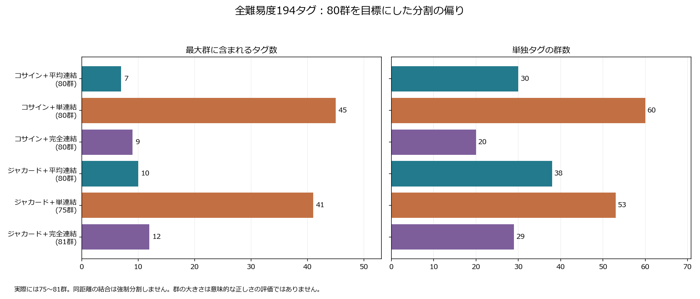

# 6通りの階層クラスタリング：個別分析

分析日：2026-11-24。対象はV4のタグ同士。全難易度194タグ、2000未満166タグです。以下の意味に関する評価は、出力されたタグ群と共起問題を点検した私の解釈です。独立した正解分類による精度評価ではありません。

**平均連結法は分野の関連を探す候補、完全連結法は群の内部の近さを保つ候補です。単連結法は今回、学習項目の分類としては大きな群に偏りました。** コサイン＋平均を第一候補とした前の所感に加え、コサイン＋完全も同程度に比較したい候補と評価します。

- [6通りを切り替える結果一覧](index.html)
- [元の実験条件・樹形図一覧](README.md)
- [追加診断CSV](analysis_diagnostics.csv) / [難易度範囲間の所属一致度](scope_partition_agreement.csv)

## 群数を近付けた比較

cut値は距離ごとに意味が違うため、全難易度で80群を目標にした結果を主な比較にします。同じ高さの結合は強制的に分割しないので、75群や81群になる条件もあります。

| 距離 | 連結法 | 実際の群数 | 最大群のタグ数 | 単独タグの群数 | 群内ペアのうち直接共起なし |
| --- | --- | ---: | ---: | ---: | ---: |
| コサイン | 平均 | 80 | 7 | 30 | 9.0% |
| コサイン | 単 | 80 | 45 | 60 | 62.2% |
| コサイン | 完全 | 80 | 9 | 20 | 0.0% |
| ジャカード | 平均 | 80 | 10 | 38 | 13.2% |
| ジャカード | 単 | 75 | 41 | 53 | 46.9% |
| ジャカード | 完全 | 81 | 12 | 29 | 0.0% |

「直接共起なし」は、同じ群に入ったタグの全ペアを数え、その中で共通問題が0のペアの割合です。橋渡しの程度を表す診断であり、誤分類率ではありません。二部マッチングとハンガリアン法のように、今回の問題では直接共起しなくても意味的には関係のある手法があります。

## 1. コサイン距離＋平均連結法

[全難易度の樹形図](all_difficulties/cosine_average/dendrogram.svg) / [2000未満](under_2000/cosine_average/dendrogram.svg)

**評価：関連する手法をある程度まとめる、バランスの取れた候補です。**

- 全難易度でcut=0.7→0.8→0.9と上げると、139→114→72群、最大群は4→4→10タグです。単連結法のような急激な巨大群は、この範囲ではできていません。
- 80群では最大7タグ・単独30群。完全連結法より、直接共起しないタグを周辺の関係から同じ群に入れる余地があります（群内ペアの9.0%）。
- cut=0.8では「最小全域木・Kruskal・Prim」「期待値DP・確率DP」「最大流・最小カット・燃やす埋める・Dinic」がまとまります。関連手法を探す観点では理解しやすい例です。
- ただし同じcutで「Grundy・Nim・線形篩」も同じ群になります。Grundyは6問、線形篩は3問で、共通はABC368 Fの1問だけです。ゲームの前処理で併用する関係が、分野の同一性として見えている点に注意が必要です。
- 2000未満ではcut=0.8で93群・最大5タグ。期待値DPと確率DPは維持されますが、多項式周辺では分割統治に代わって重心分解が同じ群に入るなど、範囲による入れ替わりがあります。

**向く用途：分野の関連や学習項目の候補を探索すること。** cut=0.8近辺の小群から点検し、80群版でどこまでまとめるか比較するのがよいと考えます。最適cutを確認したという意味ではありません。

## 2. コサイン距離＋単連結法

[全難易度の樹形図](all_difficulties/cosine_single/dendrogram.svg) / [2000未満](under_2000/cosine_single/dendrogram.svg)

**評価：今回の学習項目の分類には不向きです。共起ネットワークのつながりを探す用途に限る方がよいです。**

- 全難易度ではcut=0.7→0.8→0.9で103→36→7群、最大群は20→152→188タグです。cutを少し緩めたときの群の変化が非常に大きいです。
- cut=0.8では群内全ペアの84.0%が直接共起していません。単連結法は、近いペアが1つあれば群をつなぐため、遠いタグ同士でも連鎖の両端として同じ群になります。
- 群数を80に合わせても最大45タグ・単独60群。1群にDP、グラフ、数論、多項式などが混在します。群数を合わせるだけでは、この偏りは解消しません。
- 2000未満でもcut=0.8で最大108タグ。80群版では最大17タグへ小さくなるものの、平均6タグ・完全5タグより大きく、傾向は残ります。

**向く用途：タグ同士が少なくとも何らかの経路で結び付く範囲を調べること。** 分野・学習単位として意味の揃った群を作る目的では、今回は採用を見送ります。

## 3. コサイン距離＋完全連結法

[全難易度の樹形図](all_difficulties/cosine_complete/dendrogram.svg) / [2000未満](under_2000/cosine_complete/dendrogram.svg)

**評価：小さいまとまりを保つ有力候補です。平均連結法と並べて見る価値があります。**

- 全難易度ではcut=0.7→0.8→0.9で140→119→96群。最大群はいずれも4タグで、平均よりも大きな群への結合を抑えます。
- 80群版は最大9タグ・単独20群。平均の最大7タグより大きいので、「常に最大群が最小になる」とは言えません。完全連結法が制限するのは群内の最大ペア距離です。
- cut<1では、直接共起しないタグを同じ群に入れません。80群版でも群内の共起なしペアは0です。同じコサイン距離で計算したシルエット係数は80群時に平均0.152、完全0.164でしたが、この差は意味的正しさの証明ではありません。
- 80群にするにはcut≈0.9816まで緩める必要があります。このとき必要な最小コサイン類似度は約0.0184にすぎず、共起があれば意味まで揃うわけではありません。実際、9タグの群にMap・Set・二分探索・文字列処理・シミュレーション・ソートなどが混在します。
- 「Grundy・Nim・線形篩」は完全連結法でも残ります。これは橋渡しだけでなく、各ペア自体に共起があるためです。
- 2000未満ではcut=0.8で103群・最大4タグ、80群版では最大5タグです。ただし「重心分解・FFT」のような併用関係も群になります。

**向く用途：群内の各タグ同士に近さを要求したい分類。** 粗い大分野への統合には限界があり、距離1未満で残る群から距離1で一気に1群になるため、今回の全難易度では40群を実現できません。

## 4. ジャカード距離＋平均連結法

[全難易度の樹形図](all_difficulties/jaccard_average/dendrogram.svg) / [2000未満](under_2000/jaccard_average/dendrogram.svg)

**評価：付与問題集合の重なりを重視する、保守的な比較候補です。**

- cut=0.8で155群・単独126群。コサインより細かく残りますが、同じcutによる差なので、それだけで手法の優劣は決めません。
- 80群版では最大10タグ・単独38群。コサイン平均の最大7タグ・単独30群より、群の大きさに偏りがあります。群内の直接共起なしペアは13.2%です。
- cut=0.8では「最小全域木・Kruskal」は結び付きますが、Primは別群です。Primの2問は全てMST14問に含まれますが、集合の和に対する共通部分が小さく、距離が0.857と高いためです。これは、広い概念と少数の実装手法をまとめたい目的には不利になり得ます。
- 期待値DP27問・確率DP29問は8問共通で、ジャカード距離0.833です。全難易度ではcut=0.8で別群、2000未満では13問・15問中5問共通となり距離0.783で同じ群です。範囲で出現率が変わると境界も変わります。
- 80群版には「乱択・線形代数・一般マッチング・原始根」などのまとまりもあり、厳しい距離であっても最終的な群が意味的に純粋になるわけではありません。

**向く用途：同じ問題群で使うタグの重複を慎重に調べること。** コサインで広くまとめた結果の比較対象として残したい手法です。

## 5. ジャカード距離＋単連結法

[全難易度の樹形図](all_difficulties/jaccard_single/dendrogram.svg) / [2000未満](under_2000/jaccard_single/dendrogram.svg)

**評価：コサイン単連結より低いcutでは穏やかですが、群数を減らすと同じ問題が現れます。**

- 全難易度・cut=0.8では146群・最大7タグなので、一見すると巨大化は目立ちません。しかしcut=0.9では59群・最大68タグになります。
- 80群を目標とすると同距離結合のため75群になり、最大41タグ・単独53群。群内ペアの46.9%が直接共起していません。
- この最大群には区間データ構造、DP、数論、多項式が入り、15タグの別群には木DP・MST・最短路・探索が混在します。大きな分野名1つを付けるには広すぎるまとまりです。
- 2000未満では目標80群に対して79群・最大20タグ。全難易度より小さくなりますが、平均7タグ・完全8タグより大きいです。

**向く用途：集合の重なりが一定以上あるペアを介した連結範囲を調べること。** 学習項目の分類では単連結特有の連鎖が残るため、コサイン単連結と同様に優先度を下げます。

## 6. ジャカード距離＋完全連結法

[全難易度の樹形図](all_difficulties/jaccard_complete/dendrogram.svg) / [2000未満](under_2000/jaccard_complete/dendrogram.svg)

**評価：強く重なる小群を探す用途に向きます。大分類を作るには細かすぎる場合があります。**

- 全難易度・cut=0.8では160群・単独131群です。194タグの多くが単独のままなので、タグをまとめる効果は限定的です。
- 80群を目標にすると81群・最大12タグ・単独29群。共起なしペアは0ですが、cut≈0.99634、すなわち最小ジャカード類似度は約0.00366まで緩めています。かなり弱い重なりでも通る状態です。
- その結果、最大12タグの群はMap・基礎DP・数え上げ・二分探索・全探索・文字列処理・imos・シミュレーション・ソート・尺取り・累積和・剰余です。「全ペアに共起がある」ことと「1つの学習単位である」ことの違いがよく出ています。
- 2000未満ではcut=0.8で133群・最大4タグ、目標80群では81群・最大8タグです。全難易度より群は小さくなりますが、対象が違うのでそのまま優劣は付けません。
- 共通166タグの所属を、全難易度と2000未満の目標80群付近で比較するとARI≈0.592で、今回6手法中は最も高くなりました。これは対象範囲を変えたときの一致度であり、正しい分類に近いという指標ではありません。

**向く用途：重複の強いタグ対・小群を抽出すること。** 大分野への統合より、保守的なタグ整理の参照に使いたい方法です。

## 難易度範囲による違い

同じ名前の166タグに限定して、全難易度と2000未満で得た所属を比較しました。ここでも元の樹形図は各範囲の使用タグ全体から作っているため、問題範囲の違いと、全難易度にだけ存在する28タグの影響の両方が含まれます。純粋なランダム抽出による安定性評価ではありません。

| 距離 | 連結法 | 全難易度側の群数※ | 2000未満側の群数 | ARI |
| --- | --- | ---: | ---: | ---: |
| コサイン | 平均 | 76 | 80 | 0.560 |
| コサイン | 単 | 75 | 80 | 0.346 |
| コサイン | 完全 | 73 | 80 | 0.474 |
| ジャカード | 平均 | 74 | 80 | 0.561 |
| ジャカード | 単 | 69 | 79 | 0.354 |
| ジャカード | 完全 | 70 | 81 | 0.592 |

※全難易度の分割から共通166タグだけを取り出した後の群数。ARIは1なら同じ分割です。

## 6手法に共通する限界

1. **出現が少ないタグは、偶然の併用に強く影響されます。** 原始根と一般マッチングは、今回どちらもABC412 Gの1問だけに付いています。二値ベクトルが全く同じなので、6手法すべてで距離0です。このデータ表現だけでは別分野であることを判別できません。
2. **主解・別解・補助を同じ1で扱っています。** 「同じ解法で一緒に使う」「代わりに使える」「前処理として使う」を区別していません。少数の不自然な結合を直すために距離だけを変えても限界があります。
3. **樹形図は対称な近さから作る木です。** MSTとPrimのような上位概念・具体手法の関係と、KruskalとPrimのような別解同士の関係を、異なる種類の辺として表現していません。アルゴリズムの前提関係そのものの階層にはなりません。

私の使い分けは、**コサイン＋平均で関連分野を探索し、コサイン＋完全で群内部を点検、ジャカード＋平均／完全で保守的な比較を行う**、です。単連結法は共起ネットワークを見る補助にとどめます。最終的な学習単位として採用する前に、各群を意味で確認する必要があります。

## 追加分析の検証

群内ペア総数・直接共起なしの件数は、元の問題×タグ行列から再計算しています。最大群・単独群数は保存された所属と照合しました。割合はペア数で集計しており、巨大群がある場合はその群の寄与が大きくなります。ARIは共通タグの対応をそろえて計算しました。計算コードは `abc_all/analyze_hierarchical_v4.py`、文書生成は `abc_all/report_hierarchical_v4_analysis.py` です。
