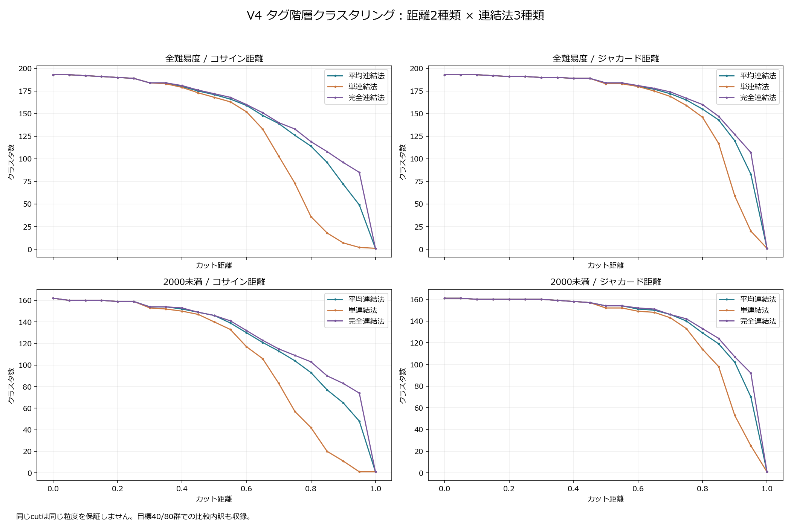

# V4：距離2種類 × 連結法3種類の階層クラスタリング

[6通りそれぞれの詳しい分析](ANALYSIS.md)：群内の共起・難易度範囲の違い・具体例・用途別評価。

実行日：2026-11-24。修正版V4の二値タグ行列で、タグ同士の階層クラスタリングを実行しました。

**今回の条件では、単連結法は連鎖的な巨大クラスタができやすく、平均連結法と完全連結法は細かい群を保ちました。** コサイン＋平均連結法をまず内訳確認の候補にします。ただし、群数やシルエット係数だけで学習内容の妥当性は確定していません。

- [操作できる結果一覧](index.html)：対象・距離・連結法・cutを切り替え、クラスタ内のタグを検索できます。
- [群数の比較図](comparison.png) / [拡大用SVG](comparison.svg)
- [全252条件の数値](parameter_sweep.csv)：12条件 × cut 0.00〜1.00、0.05刻み
- [目標40/80群との比較](matched_cluster_counts.csv)：同じ距離のcutだけでなく、群数を近付けた結果



## 固定した条件

| 項目 | 全難易度 | 2000未満 |
| --- | ---: | ---: |
| 問題数 | 3,012 | 2,473 |
| タグ付き問題数 | 2,692 | 2,159 |
| タグなし問題数 | 320 | 314 |
| 使用タグ数 | 194 | 166 |
| 未使用タグ数 | 72 | 100 |

- 入力は `output_v4/problem_tag_matrix.csv`。主解・別解・補助はすべて1、概念・証明のタグは含めません。
- クラスタリング対象は**タグ**。問題は出現パターンを表す特徴量です。
- 難易度不明の問題は全難易度に含め、2000未満には含めません。片方は同じV4行列から行だけを抽出しました。
- 各対象内で0件のタグだけを除外。1問だけのタグも保持しています。今回は使用タグに共起ゼロの孤立タグはありません。
- 重み付け・SVD・NMF・旧実験の手動制約は適用していません。
- 主解と別解で併記されたタグも共起するため、近さが同じ実装手順・同じ学習単位を意味するとは限りません。

## cut=0.8の比較

以下は同じ数値cutでの挙動比較です。コサインとジャカードで同じ粒度という意味ではありません。

| 距離 | 連結法 | 全難易度の群数 | 最大群のタグ数 | 2000未満の群数 | 最大群のタグ数 |
| --- | --- | ---: | ---: | ---: | ---: |
| コサイン | 平均連結法 | 114 | 4 | 93 | 5 |
| コサイン | 単連結法 | 36 | 152 | 42 | 108 |
| コサイン | 完全連結法 | 119 | 4 | 103 | 4 |
| ジャカード | 平均連結法 | 155 | 4 | 129 | 4 |
| ジャカード | 単連結法 | 146 | 7 | 114 | 8 |
| ジャカード | 完全連結法 | 160 | 4 | 133 | 4 |

全難易度のコサイン＋単連結法では、cut=0.7は103群・最大20タグ、0.8は36群・最大152タグ、0.9は7群・最大188タグでした。少数の近いタグが橋渡しになり、群が連鎖して結合する挙動です。ジャカード＋単連結法でも、cut=0.9では最大68タグの群ができています。

平均連結法は群間の全タグペアの平均距離、単連結法は最小距離、完全連結法は最大距離で結合します。[SciPyの定義](https://docs.scipy.org/doc/scipy/reference/generated/scipy.cluster.hierarchy.linkage.html)。

## ほぼ同じ群数での比較：目標80群

| 対象 | 距離 | 連結法 | 実際の群数 | cut | 最大群のタグ数 |
| --- | --- | --- | ---: | ---: | ---: |
| 全難易度 | コサイン | 平均連結法 | 80 | 0.887019 | 7 |
| 全難易度 | コサイン | 単連結法 | 80 | 0.749127 | 45 |
| 全難易度 | コサイン | 完全連結法 | 80 | 0.981608 | 9 |
| 全難易度 | ジャカード | 平均連結法 | 80 | 0.951638 | 10 |
| 全難易度 | ジャカード | 単連結法 | 75 | 0.888889 | 41 |
| 全難易度 | ジャカード | 完全連結法 | 81 | 0.996337 | 12 |
| 2000未満 | コサイン | 平均連結法 | 80 | 0.845798 | 6 |
| 2000未満 | コサイン | 単連結法 | 80 | 0.706635 | 17 |
| 2000未満 | コサイン | 完全連結法 | 80 | 0.912294 | 5 |
| 2000未満 | ジャカード | 平均連結法 | 80 | 0.937500 | 7 |
| 2000未満 | ジャカード | 単連結法 | 79 | 0.866667 | 20 |
| 2000未満 | ジャカード | 完全連結法 | 81 | 0.978723 | 8 |

単連結法は群数をそろえても大きい群と単独群が混在します。全難易度・目標80群では、コサイン＋単連結法は80群中の最大群が45タグ、平均連結法は7タグ、完全連結法は9タグでした。

**同じ高さの結合は分割しません。** そのため目標群数に一致しない条件があります。目標40群では、全難易度の完全連結法は距離1未満で残る群から距離1で一気に1群になり、40群を実現できません。保存した目標40群の内訳は「最も近い実現可能な群数」で、両距離とも実際は1群です。これは推奨設定ではありません。2000未満では完全連結法の最も近い結果は72群／76群でした。

## 内訳から見えること

全難易度・コサイン＋平均連結法・cut=0.8では、例えば以下が同じ群です。

- 最大流・最小カット・燃やす埋める・Dinic
- 分割統治・多項式/FPS・畳み込み・FFT
- Heap・最短経路・Dijkstra・疎グラフ向けDijkstra
- BIT・Segment Tree・座標圧縮

一方で、Union-Find・BFS・DFS・連結成分分解も同じ群です。完全連結法ではGrundy・Nim・線形篩が同じ群になる例があります。共起だけによる分類は、補助手法や少数問題由来の関係をそのまま反映します。今回の結果は候補となる分類であり、タグの同義性や粒度の一致を保証しません。

## 樹形図・クラスタ内訳

樹形図はタグ名を左、結合距離を右に表示します。枝色はcut=0.7、破線は0.7・0.8・0.9です。色は繰り返され、分野名に対応しません。SVGを拡大すると全タグを読めます。

### 全難易度

| 距離 | 連結法 | 樹形図 | cut=0.7 | cut=0.8 | cut=0.9 | 目標80群 |
| --- | --- | --- | --- | --- | --- | --- |
| コサイン | 平均連結法 | [PNG](all_difficulties/cosine_average/dendrogram.png)・[SVG](all_difficulties/cosine_average/dendrogram.svg) | [内訳](all_difficulties/cosine_average/clusters_cut_0.7.md) | [内訳](all_difficulties/cosine_average/clusters_cut_0.8.md) | [内訳](all_difficulties/cosine_average/clusters_cut_0.9.md) | [内訳](all_difficulties/cosine_average/clusters_target_80.md) |
| コサイン | 単連結法 | [PNG](all_difficulties/cosine_single/dendrogram.png)・[SVG](all_difficulties/cosine_single/dendrogram.svg) | [内訳](all_difficulties/cosine_single/clusters_cut_0.7.md) | [内訳](all_difficulties/cosine_single/clusters_cut_0.8.md) | [内訳](all_difficulties/cosine_single/clusters_cut_0.9.md) | [内訳](all_difficulties/cosine_single/clusters_target_80.md) |
| コサイン | 完全連結法 | [PNG](all_difficulties/cosine_complete/dendrogram.png)・[SVG](all_difficulties/cosine_complete/dendrogram.svg) | [内訳](all_difficulties/cosine_complete/clusters_cut_0.7.md) | [内訳](all_difficulties/cosine_complete/clusters_cut_0.8.md) | [内訳](all_difficulties/cosine_complete/clusters_cut_0.9.md) | [内訳](all_difficulties/cosine_complete/clusters_target_80.md) |
| ジャカード | 平均連結法 | [PNG](all_difficulties/jaccard_average/dendrogram.png)・[SVG](all_difficulties/jaccard_average/dendrogram.svg) | [内訳](all_difficulties/jaccard_average/clusters_cut_0.7.md) | [内訳](all_difficulties/jaccard_average/clusters_cut_0.8.md) | [内訳](all_difficulties/jaccard_average/clusters_cut_0.9.md) | [内訳](all_difficulties/jaccard_average/clusters_target_80.md) |
| ジャカード | 単連結法 | [PNG](all_difficulties/jaccard_single/dendrogram.png)・[SVG](all_difficulties/jaccard_single/dendrogram.svg) | [内訳](all_difficulties/jaccard_single/clusters_cut_0.7.md) | [内訳](all_difficulties/jaccard_single/clusters_cut_0.8.md) | [内訳](all_difficulties/jaccard_single/clusters_cut_0.9.md) | [内訳](all_difficulties/jaccard_single/clusters_target_80.md) |
| ジャカード | 完全連結法 | [PNG](all_difficulties/jaccard_complete/dendrogram.png)・[SVG](all_difficulties/jaccard_complete/dendrogram.svg) | [内訳](all_difficulties/jaccard_complete/clusters_cut_0.7.md) | [内訳](all_difficulties/jaccard_complete/clusters_cut_0.8.md) | [内訳](all_difficulties/jaccard_complete/clusters_cut_0.9.md) | [内訳](all_difficulties/jaccard_complete/clusters_target_80.md) |

### 2000未満

| 距離 | 連結法 | 樹形図 | cut=0.7 | cut=0.8 | cut=0.9 | 目標80群 |
| --- | --- | --- | --- | --- | --- | --- |
| コサイン | 平均連結法 | [PNG](under_2000/cosine_average/dendrogram.png)・[SVG](under_2000/cosine_average/dendrogram.svg) | [内訳](under_2000/cosine_average/clusters_cut_0.7.md) | [内訳](under_2000/cosine_average/clusters_cut_0.8.md) | [内訳](under_2000/cosine_average/clusters_cut_0.9.md) | [内訳](under_2000/cosine_average/clusters_target_80.md) |
| コサイン | 単連結法 | [PNG](under_2000/cosine_single/dendrogram.png)・[SVG](under_2000/cosine_single/dendrogram.svg) | [内訳](under_2000/cosine_single/clusters_cut_0.7.md) | [内訳](under_2000/cosine_single/clusters_cut_0.8.md) | [内訳](under_2000/cosine_single/clusters_cut_0.9.md) | [内訳](under_2000/cosine_single/clusters_target_80.md) |
| コサイン | 完全連結法 | [PNG](under_2000/cosine_complete/dendrogram.png)・[SVG](under_2000/cosine_complete/dendrogram.svg) | [内訳](under_2000/cosine_complete/clusters_cut_0.7.md) | [内訳](under_2000/cosine_complete/clusters_cut_0.8.md) | [内訳](under_2000/cosine_complete/clusters_cut_0.9.md) | [内訳](under_2000/cosine_complete/clusters_target_80.md) |
| ジャカード | 平均連結法 | [PNG](under_2000/jaccard_average/dendrogram.png)・[SVG](under_2000/jaccard_average/dendrogram.svg) | [内訳](under_2000/jaccard_average/clusters_cut_0.7.md) | [内訳](under_2000/jaccard_average/clusters_cut_0.8.md) | [内訳](under_2000/jaccard_average/clusters_cut_0.9.md) | [内訳](under_2000/jaccard_average/clusters_target_80.md) |
| ジャカード | 単連結法 | [PNG](under_2000/jaccard_single/dendrogram.png)・[SVG](under_2000/jaccard_single/dendrogram.svg) | [内訳](under_2000/jaccard_single/clusters_cut_0.7.md) | [内訳](under_2000/jaccard_single/clusters_cut_0.8.md) | [内訳](under_2000/jaccard_single/clusters_cut_0.9.md) | [内訳](under_2000/jaccard_single/clusters_target_80.md) |
| ジャカード | 完全連結法 | [PNG](under_2000/jaccard_complete/dendrogram.png)・[SVG](under_2000/jaccard_complete/dendrogram.svg) | [内訳](under_2000/jaccard_complete/clusters_cut_0.7.md) | [内訳](under_2000/jaccard_complete/clusters_cut_0.8.md) | [内訳](under_2000/jaccard_complete/clusters_cut_0.9.md) | [内訳](under_2000/jaccard_complete/clusters_target_80.md) |

各フォルダにはlinkage.csv、内訳CSV・JSON、cut別数値もあります。[代表タグ対の比較](example_pairs.csv)、[クラスタ所属の一致度ARI](partition_agreement.csv)、各対象の全タグ対の距離表も保存しました。

## 検証

入力V4ファイルのハッシュ不変、距離の集合件数からの独立計算との一致、12条件の全2,148結合について最小の許容距離の組を選んでいることと結合高を検証しました。36個の表示用分割のタグ所属・問題ID和集合・群数も照合しました。単連結法は距離閾値グラフの連結成分と一致し、完全連結法は各群の最大ペア距離がcut以下であることも確認済みです。[verification.json](verification.json)

シルエット係数はそれぞれの元距離で計算しました。異なる距離の数値をそのまま分類精度として比較していません。コーフェネティック相関は元距離を樹形図がどれだけ再現するかの指標であり、意味の正しさではありません。独立した正解分類による評価はしていません。

## 再実行

ワークスペース直下で実行します。

```powershell
.\.venv-clustering\Scripts\python.exe -X utf8 abc_all/hierarchical_v4_experiment.py
.\.venv-clustering\Scripts\python.exe -X utf8 abc_all/verify_hierarchical_v4.py
.\.venv-clustering\Scripts\python.exe -X utf8 abc_all/report_hierarchical_v4.py
```

入力の版・ハッシュ、NumPy/SciPy等の版、同距離時の扱いは [summary.json](summary.json) に記録しています。距離は [コサイン](https://docs.scipy.org/doc/scipy/reference/generated/scipy.spatial.distance.cosine.html)・[ジャカード](https://docs.scipy.org/doc/scipy/reference/generated/scipy.spatial.distance.jaccard.html) の定義に従います。追加API呼出しは0回です。
