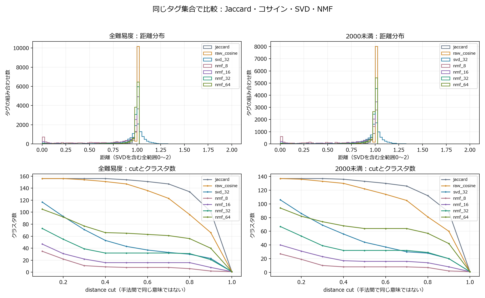

# NMFによるタグ階層クラスタリングの比較実験

実験日：2026-11-19 / 入力：2026-11-05固定データ / 追加API費用：0円

## 結果の要点

**NMFはSVDより高いシルエット係数を示したが、意味的な混在が残った。学習単位としての粒度がそろったとは判断していない。**

- 主表示は事前に決めた32成分・NNDSVDa初期化で、最適な設定を選んだものではない。
- cut=0.7では両対象とも32群。シルエット係数は全難易度0.793、2000未満0.798。
- 「文字列処理」1タグは、SVDと比較対象をそろえるため別枠に残した。NMFでは必ず表現できないという意味ではない。
- 全難易度では「最小全域木・Kruskal・Prim・Union-Find」が同じ群になった。一方「連分数・Bellman-Ford」や「後退解析・Suffix Automaton」の混在が残る。
- 初期値を変えると群数がほぼ同じでもタグの所属が変化した。全18回の学習は指定した収束条件を満たしたが、大域最適解や意味的正しさを保証しない。
- 人による独立した意味的評価は未実施。SVDの出力と入力データはハッシュ照合で変更なしを確認した。

## 1. データ

| 対象 | 問題数 | 元の使用タグ | 今回の比較タグ | 別枠 | 未使用タグ |
|---|---:|---:|---:|---|---:|
| 全難易度 | 3,012 | 157 | 156 | 文字列処理1種類 | 109 |
| 2000未満 | 2,473 | 139 | 138 | 文字列処理1種類 | 127 |

元の問題・タグ付与を固定し、SVD版と全く同じ156／138タグを比較した。タグ名・問題文・解説文は特徴量に使わない。1問だけ付いたタグも、単独タグのクラスタも問題数で除外しない。

行列の0には未判定や付け漏れが含まれ得る。0を適用不能という正解ラベルとみなした実験ではなく、現在の観測された対応行列を近似する実験である。

## 2. 計算方法

1. 問題×タグの行列を、タグ×問題に転置し、タグごとの行をL2正規化する。SVDと同じ前処理。
2. A ≈ WH、W≥0、H≥0 を、二乗Frobenius再構成誤差を小さくするように計算する。
3. Hの各成分の行のL2ノルムを1にそろえ、対応するWの列に元のノルムを掛ける。WHの値は維持する。
4. この尺度をそろえたWの行をタグの表現とし、コサイン距離で平均連結法の階層クラスタリングを行う。

NMFはWのある列を定数倍し、Hの対応する行をその逆数倍しても再構成が同じになる。Wのコサイン距離がこの任意の尺度に影響されないよう、上記3の正規化を入れた。ただし、この表現の選択自体も設計上の選択である。

| 設定 | 値 |
|---|---|
| 成分数 | 8・16・32・64 |
| 主表示 | 32成分（最適値という意味ではない） |
| 初期化 | NNDSVDa、seed=42 |
| ソルバー | 座標降下法（cd） |
| 損失 | Frobenius、正則化なし |
| 収束許容値・反復上限 | 1e-5・5,000回 |
| 初期値の感度確認 | random初期化、seed=0〜4、32成分 |
| cut | 0.1〜1.0、0.1刻み |

係数は所属確率ではない。NMFの非負ベクトル同士ではコサイン距離は0〜1となる。SVDの距離範囲0〜2と異なり、同じcutでも同じ意味にはならない。

## 3. cut=0.7での比較

| 対象 | 手法 | 群数 | シルエット係数 | コーフェネティック相関 |
|---|---|---:|---:|---:|
| 全難易度 | Jaccard | 147 | 0.035 | 0.863 |
| 全難易度 | 圧縮前コサイン | 123 | 0.107 | 0.784 |
| 全難易度 | SVD 32次元 | 33 | 0.529 | 0.697 |
| 全難易度 | NMF 8成分 | 8 | 0.744 | 0.865 |
| 全難易度 | NMF 16成分 | 16 | 0.798 | 0.883 |
| 全難易度 | NMF 32成分 | 32 | 0.793 | 0.860 |
| 全難易度 | NMF 64成分 | 61 | 0.677 | 0.872 |
| 2000未満 | Jaccard | 126 | 0.064 | 0.890 |
| 2000未満 | 圧縮前コサイン | 105 | 0.154 | 0.796 |
| 2000未満 | SVD 32次元 | 30 | 0.485 | 0.694 |
| 2000未満 | NMF 8成分 | 8 | 0.770 | 0.854 |
| 2000未満 | NMF 16成分 | 16 | 0.751 | 0.867 |
| 2000未満 | NMF 32成分 | 32 | 0.798 | 0.875 |
| 2000未満 | NMF 64成分 | 64 | 0.694 | 0.876 |

各係数は各手法自身の距離空間で計算した。数値が高いことを分類精度の改善や粒度統一の成功とは解釈しない。クラスタ数をSVD32・cut=0.7の33／30群、Jaccard・cut=0.9の101／88群に合わせた比較も保存したが、距離空間の違いは残る。

- [群数をそろえた比較：全難易度](all_difficulties/matched_cluster_counts.csv)
- [群数をそろえた比較：2000未満](under_2000/matched_cluster_counts.csv)

## 4. 32成分の画像と内訳

タグ名は左側、結合は右側。各タグのすぐ右から枝が始まり、横軸は右へ進むほど距離が大きくなる。色は繰り返され、色自体は分野名ではない。

| 対象 | cut | 群数 | シルエット | PNG | SVG | 内訳CSV | 群一覧 |
|---|---:|---:|---:|---|---|---|---|
| 全難易度 | 0.7 | 32 | 0.793 | [画像](all_difficulties/nmf_32/dendrogram_cut_0.7.png) | [拡大用](all_difficulties/nmf_32/dendrogram_cut_0.7.svg) | [CSV](all_difficulties/nmf_32/cluster_members_cut_0.7.csv) | [一覧](all_difficulties/nmf_32/clusters_cut_0.7.md) |
| 全難易度 | 0.8 | 31 | 0.759 | [画像](all_difficulties/nmf_32/dendrogram_cut_0.8.png) | [拡大用](all_difficulties/nmf_32/dendrogram_cut_0.8.svg) | [CSV](all_difficulties/nmf_32/cluster_members_cut_0.8.csv) | [一覧](all_difficulties/nmf_32/clusters_cut_0.8.md) |
| 全難易度 | 0.9 | 21 | 0.484 | [画像](all_difficulties/nmf_32/dendrogram_cut_0.9.png) | [拡大用](all_difficulties/nmf_32/dendrogram_cut_0.9.svg) | [CSV](all_difficulties/nmf_32/cluster_members_cut_0.9.csv) | [一覧](all_difficulties/nmf_32/clusters_cut_0.9.md) |
| 2000未満 | 0.7 | 32 | 0.798 | [画像](under_2000/nmf_32/dendrogram_cut_0.7.png) | [拡大用](under_2000/nmf_32/dendrogram_cut_0.7.svg) | [CSV](under_2000/nmf_32/cluster_members_cut_0.7.csv) | [一覧](under_2000/nmf_32/clusters_cut_0.7.md) |
| 2000未満 | 0.8 | 29 | 0.734 | [画像](under_2000/nmf_32/dendrogram_cut_0.8.png) | [拡大用](under_2000/nmf_32/dendrogram_cut_0.8.svg) | [CSV](under_2000/nmf_32/cluster_members_cut_0.8.csv) | [一覧](under_2000/nmf_32/clusters_cut_0.8.md) |
| 2000未満 | 0.9 | 20 | 0.499 | [画像](under_2000/nmf_32/dendrogram_cut_0.9.png) | [拡大用](under_2000/nmf_32/dendrogram_cut_0.9.svg) | [CSV](under_2000/nmf_32/cluster_members_cut_0.9.csv) | [一覧](under_2000/nmf_32/clusters_cut_0.9.md) |

同じ対象・成分数では、cutを変えても樹形は同じでカット位置と枝色が変わる。各群数には別枠の「文字列処理」1タグを含まない。

## 5. 具体例と指標の読み方

### 5.1 意味的に混在が疑われる例が残る

全難易度・NMF32・cut=0.7の例：

- 最小全域木・Kruskal・Prim・Union-Find：関連性は理解しやすいが、解法とデータ構造を同じ学習単位にするかは別途判断が必要。
- 最大流・最小カット・Dinicなど：フロー関連のまとまり。
- 連分数・Bellman-Ford・Stern-Brocot：SVDで気になった組がNMFでも同じ群に入った。さらに二部マッチングや最小費用流なども同じ群。
- 後退解析・Suffix Automaton：この2タグも引き続き同じ群。
- Map・Trie・Aho-Corasick・離散対数など：異なる学習内容の混在を確認したい群。

これらは探索的な確認例であり、独立した正解ラベルに基づく評価ではない。SVDと同じ不自然な組が残ったことから、元の付与や共起情報・学習単位の定義を確認する必要があると考える。

### 5.2 高いシルエット係数と成分数の関係

cut=0.7のNMF群数は、全難易度8／16／32／61、2000未満8／16／32／64だった。成分数の設定に強く影響されている。

タグごとに最も係数の大きい成分を1つ選んで分けた結果と、階層クラスタリング結果とのARIは32成分で以下となった。

| 対象 | 最大成分による割当とのARI | 最大成分の係数比の平均 |
|---|---:|---:|
| 全難易度 | 0.965 | 74.7% |
| 2000未満 | 0.966 | 75.3% |

ARIはここでは2つの分け方の一致度であり、正解率ではない。最大成分の係数比も確率ではない。この一致が高いことから、非負で疎な成分表現により数値上の分離が強くなっている可能性がある。高いシルエット係数だけで学習単位として妥当とは判断しない。

### 5.3 初期値を変えると、群数が近くても所属は変わる

| 対象 | random初期化5回の群数範囲 | 主表示とのARI範囲 | 近傍5タグの平均一致率 |
|---|---:|---:|---:|
| 全難易度 | 31〜32 | 0.478〜0.707 | 59.8% |
| 2000未満 | 32〜32 | 0.616〜0.746 | 72.2% |

同じ入力・同じ32成分でも、初期値によって解が変わった。全学習は収束判定を満たしたが、最良の大域解や同じクラスタ所属が得られることを保証しない。今回は問題の部分抽出による安定性をNMFで再評価していないため、SVDの部分抽出結果との直接比較は行わない。

### 5.4 距離1の問題は部分的に残る

| 対象 | NMF32で距離1の組の割合 | 距離の中央値 |
|---|---:|---:|
| 全難易度 | 49.4% | 0.999997 |
| 2000未満 | 48.2% | 0.999977 |

距離1の判定の数値許容差は1e-10。NMFの非負の係数ベクトルが異なる成分だけを持つと、コサイン類似度0・距離1になる。Jaccardより同率は減ったが、約半数が距離1であり、遠いタグの違いを全面的に表現できたとはいえない。



## 6. 追跡できるデータ

- [固定した例のタグ間距離と所属](example_pairs.csv)
- [初期値による変化](initialization_stability.csv)
- [成分への偏り](component_diagnostics.csv)
- [人手レビュー用の候補](review_pairs.csv)
- [全パラメータの結果](parameter_sweep.csv)
- [全難易度：近くなった共起なしの組](all_difficulties/newly_close_without_overlap.csv)
- [2000未満：近くなった共起なしの組](under_2000/newly_close_without_overlap.csv)
- [全難易度：各成分に強く関わるタグ](all_difficulties/nmf_32/component_top_tags.csv)
- [全難易度：各成分に強く関わる問題](all_difficulties/nmf_32/component_top_problems.csv)
- [2000未満：各成分に強く関わるタグ](under_2000/nmf_32/component_top_tags.csv)
- [2000未満：各成分に強く関わる問題](under_2000/nmf_32/component_top_problems.csv)

各成分への係数を追える点は、候補群の理由を人が確認する補助になる。ただし、成分番号は意味ラベルではなく、確率や正解の分野名ともみなさない。今回の不自然なまとまりが改善されたとは結論しない。

## 7. 結論と限界

今回のFrobenius損失・正則化なし・指定した初期化と前処理では、NMFは数値上よく分かれた表現を作ったが、粒度統一としての採用判断には至らない。NMF一般が不適当と断定する実験でもない。

次は、学習単位としてまとめたい・分けたいタグペアを独立に確認し、固定した評価例で各手法を比較する。元の少数問題への付与や背景説明の誤付与も確認する。正則化や他の損失を検討する場合も、評価基準を先に固定する。

## 8. 検証と再実行

全18回の非負性・成分尺度・再構成誤差・SVDによる最良ランク近似の下界、距離・クラスタ所属・問題和集合・指標・初期値比較・PNG/SVGの整合性を独立に確認した。結果：[verification.json](verification.json)。計算の整合性の確認であり、意味的な正しさの検証ではない。

リポジトリ直下で、既存のrequirements-clustering.txtの環境を使う。新規のモデルダウンロード・有料APIは不要。

```powershell
.\.venv-clustering\Scripts\python.exe -X utf8 abc_all\nmf_experiment.py
.\.venv-clustering\Scripts\python.exe -X utf8 abc_all\verify_nmf_experiment.py
.\.venv-clustering\Scripts\python.exe -X utf8 abc_all\report_nmf_experiment.py
```

計算だけは --stage compute、画像だけは --stage render で再実行できる。読み込みと集計の一部は既存のsvd_experiment.pyを再利用する。

参考：[scikit-learn NMF](https://scikit-learn.org/stable/modules/generated/sklearn.decomposition.NMF.html)。
