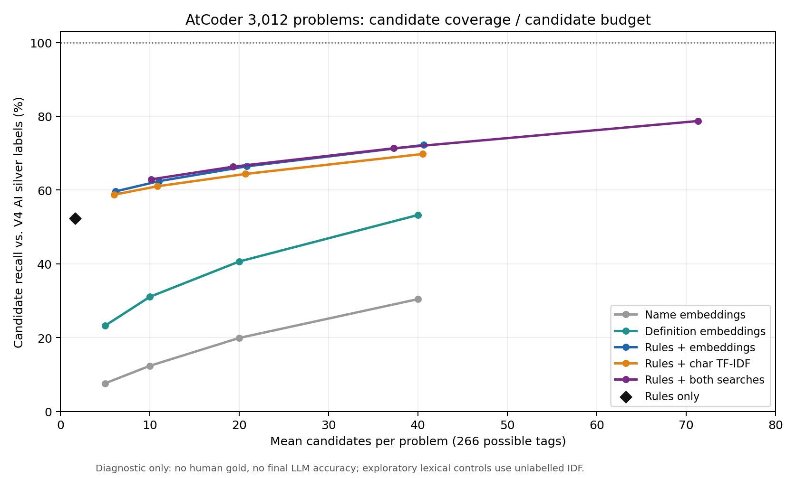

# 埋め込み＋ルールによるタグ候補生成の試作

続き：[日本語定義・関連候補拡張の改善結果](japanese_v2/README.md)。旧候補を保持する改善版は候補再現率84.4%、確率DP27/29件・期待値DP24/27件が候補に残りました。以下は比較用に保存した初回の試作結果です。

2026-11-26、全3,012問・266タグで実行しました。**処理は実現できましたが、今回のモデル・説明文では取りこぼしが多く、本番のタグ付けには採用できません。** 既存V4タグ・クラスタリング結果は変更していません。

## 実測結果

候補再現率は「V4にある問題×タグ7,708組のうち、生成した候補に残った割合」です。V4は過去のAIレビューによる比較用ラベル（silver）で、人手の正解データではありません。**最終タグ付けの正解率・適合率・F1ではありません。**

| 方法 | 平均候補数 / 266 | 候補再現率 | V4タグが全部残る問題の割合※ |
|---|---:|---:|---:|
| 既存ルールのみ | 1.6 | 52.4% | 21.0% |
| タグ名の埋め込み 上位20 | 20.0 | 19.9% | 11.3% |
| タグ名＋説明文＋別名の埋め込み 上位20 | 20.0 | 40.6% | 17.9% |
| ルール ∪ 説明文埋め込み 上位20 | 20.8 | **66.4%** | 38.2% |
| ルール ∪ 説明文埋め込み 上位40 | 40.6 | 72.2% | 44.9% |
| 全タグを候補にする対照条件 | 266.0 | 100.0% | 100.0% |

※タグがある2,692問を分母とし、タグなし320問を自動的な成功に数えていません。全タグ条件の100%は集合の包含によるもので、判定精度を意味しません。

上位20＋ルールでは、主解タグ76.9%、別解タグ68.6%、補助手法タグ58.9%が候補に残りました。役割別集計は、V4の各問題×タグに保存された先頭の役割を使っています。

**確率DPは29件中6件、期待値DPは27件中4件**しか候補に残りませんでした。上位40＋ルールでも、それぞれ6件・7件です。従来の名前一致ルールだけでは確率DP1件・期待値DP0件で、意味判断によって補っていた部分を今回の候補生成では再現できていません。

[全条件CSV](output/candidate_metrics.csv) / [タグ別CSV](output/candidate_tag_metrics.csv) / [取りこぼした問題・タグ](output/candidate_misses.csv) / [役割別](output/candidate_role_metrics.csv) / [希少タグ別](output/candidate_frequency_metrics.csv)



[図のPNG](output/candidate_tradeoff.png) / [SVG](output/candidate_tradeoff.svg)

## 追加の比較・診断

初回の結果を確認した後の探索的な比較です。独立テスト上で選んだ最適条件ではありません。

| 比較条件 | 平均候補数 | 候補再現率 |
|---|---:|---:|
| E5の両側をquery接頭辞に変更＋ルール、上位20 | 21.0 | 64.2% |
| 文字TF-IDF 上位20のみ | 20.0 | 43.2% |
| 文字TF-IDF 上位20＋ルール | 20.7 | 64.4% |
| TF-IDF 上位20 ∪ 埋め込み上位20 ∪ ルール | 37.3 | 71.3% |
| TF-IDF 上位40 ∪ 埋め込み上位40 ∪ ルール | 71.3 | 78.7% |

候補数の増加も効くため、融合条件の改善をそのまま手法の優位性とは解釈できません。約40候補では、説明文埋め込み＋ルールの72.2%と融合条件の71.3%は近い結果です。

埋め込み上位20に「2円の共通接線」が2,636問、「円と円の交点」が2,173問で出現しました。V4での出現数はそれぞれ0件・2件です。少数のタグが広い問題に近くなる偏りが見られます。日本語解説に対する英語中心の手書き説明文、モデルの領域適合、量子化、最大値集約のどれが原因かは未確定です。接頭辞を変えるだけでは解消しませんでした。

[接頭辞比較](output/symmetric_candidate_metrics.csv) / [TF-IDF比較](output/lexical_candidate_metrics.csv) / [偏りと入力文字数](output/diagnostic_summary.json)

## 実装

1. 固定コーパスの問題文・解説を読み、補足解説192件をURLで置換・追加する。
2. 既存V3の解説範囲フィルターを通し、名前・コード・説明パターンから候補を出す。一致だけでタグを確定しない。
3. 本文を最大420文字、重複64文字の窓に分割する。256トークン以内になるまで短くし、長文の末尾も処理する。意味的な段落・解法単位の分割は未実装。
4. 全19,814窓と266タグをローカルで埋め込む。各タグについて、その問題の各窓との最大コサイン類似度で順位を付ける。
5. 上位20件とルール候補の和集合をAIに渡す。主解・制約内の別解・補助を区別し、解法、計算量、根拠の原文引用を要求する。
6. `candidate_insufficient`が出た問題は全266タグに戻して再判定する。再判定でも不足する場合は保留を残す。

モデルは[intfloat/multilingual-e5-small](https://huggingface.co/intfloat/multilingual-e5-small)。固定revision `614241f622f53c4eeff9890bdc4f31cfecc418b3`のONNX int8版をCPUで使用しました。384次元、attention mask付き平均プーリングとL2正規化。初回条件は本文に`query: `、タグ側に`passage: `を付けています。上限256での切り捨ては全入力で0件でした。[公式説明](https://huggingface.co/intfloat/multilingual-e5-small)に基づく実装です。

266件の[検索用説明文](tag_descriptions.tsv)は手書きの定義です。候補生成コードはV4の問題別タグを読みません。比較ラベルは生成後の評価処理で初めて読みます。ただし、既存ルール・定義の設計者は過去のレビュー結果を知っているため、未見データに対する厳密な独立評価ではありません。

解説PDFの範囲切り出しも課題でした。AI入力ではV3の範囲処理に加え、日本語・英語の問題見出しによるガードで別問題の本文を除き、範囲外の検索引用も除外します。検索用の全ベクトルをこの追加ガードで再作成した実験ではないため、検索順位には旧範囲のノイズが残りえます。対象解説の過剰除外も今後の監査対象です。

## AI判定をどこまで実行したか

**外部LLM APIによる全件判定は未実施です。** 接続先・モデル・認証の設定がなく、外部推論呼び出しは0回です。以下を区別して保存しています。

- 全3,012問の候補とAI入力を生成。[代表20問の入力](output/pilot_requests_scoped.jsonl)も保存。
- この会話のAIが作成した[10問の判定例](output/session_demo_judgments.jsonl)を保存。独立した別モデルのバッチ判定や人手の正解データではなく、候補不足6問を含む説明用の例です。
- ABC319 Cについて、全266タグへ戻す[入力](output/fallback_request_abc319c.jsonl)と[再判定例](output/session_fallback_judgment.json)を作成。初回に漏れたbit DP・確率DPを、開示済み集合512状態の実行可能な別解として扱いました。
- この別解の整数版を実装し、4種類の盤面で9!通りの全順列の計数と一致することを[確認](output/alternative_witness_check.json)。同じ遷移で未開示マスを`1/(9-|S|)`ずつ選ぶ確率DPにできます。
- [API実行器](judge.py)と[候補不足時の再判定処理](run_with_fallback.py)を実装。引用・候補ID・役割・重複・採否の整合を検査し、再開時はプロンプトhashとモデルを照合します。

例では、Scc Puzzleのタイトルから強連結成分を付けないこと、ABC404 Dの余談にあるbit DPを本問の解法と混同しないこと、ABC417 DのタイトルExpectationを期待値DPと誤認しないことも扱っています。BFSとDFSは別タグのままで、類似度を理由に統合しません。

候補不足の自己申告は漏れを必ず検出する仕組みではありません。**申告のない問題にも候補外の抜き取り監査が必要です。** 10問は選定した説明用の例であり、6/10から母集団の検出率は推定できません。早期の小バッチ試行と全件試行では20問全ての候補集合に差が出たため、正式な全件試行の保存入力で判定ファイルを再検証しました。バッチ構成等への感度は未切り分けです。

20問の対照入力で、全文字数は全266候補条件に対し平均11.3%でした。同じ形式で候補説明・検索引用を付けたUnicode文字数であり、**実LLMトークン数・料金・速度は未計測**です。同じ本文の重複提示も未最適化です。上位20＋ルールの候補数自体は全266タグから92.2%減っています。

## 論文に向けた次の実験

今回の結果は「候補を絞るだけでは、主解・別解・補助を含む方針に必要な再現率に届かない」という診断です。次は日本語の定義・適用条件を整備し、BFS→最短路、DP各種→基礎DPなどの関係を**候補の拡張**に利用する実験が考えられます。関連タグを最終ラベルとして自動採用する意味ではありません。名前の出ない別解には、解法自体の生成と検証も必要です。

研究用には、指定した参考解法群の範囲で主解・別解・補助を人手確認した正解集合を用意し、開発用とテスト用をコンテスト単位等で分離します。候補再現率、希少タグのmacro再現率、最終判定の適合率・再現率・F1、保留率、再判定率、実トークン数、処理時間を測定します。APIモデルと設定を固定し、全タグ直接判定、ルール、TF-IDF、埋め込み、融合を同じ候補予算でも比較する必要があります。

検索後にLLMで判定する構成には[ICXMLなどの先行研究](https://aclanthology.org/2024.findings-naacl.134/)があります。貢献を主張するなら、解法単位の採否基準、実行可能な別解の扱い、証明や参考言及との区別、候補漏れの検出・回復、独立した検証結果に置くのが妥当です。今回のsilver照合だけで性能向上や新規性は主張できません。

## 再実行

リポジトリのルートで実行します。Python 3.9.13。モデル重み・埋め込みキャッシュ・全件プロンプト等の大きな再生成可能ファイルは`.gitignore`に追加しました。[生成記録](output/generation_summary.json)に入力・モデルのhashがあります。

```powershell
$py = '.\.venv-clustering\Scripts\python.exe'
& $py -m pip install -r abc_all\retrieval_trial\requirements.txt
& $py -X utf8 abc_all\download_retrieval_model.py
& $py -X utf8 abc_all\retrieval_trial\generate.py
& $py -X utf8 abc_all\retrieval_trial\evaluate.py
& $py -X utf8 abc_all\retrieval_trial\scope_requests.py --input abc_all\retrieval_trial\output\llm_requests.jsonl --output abc_all\retrieval_trial\output\llm_requests_scoped.jsonl
& $py -X utf8 abc_all\retrieval_trial\scope_requests.py --input abc_all\retrieval_trial\output\pilot_requests.jsonl --output abc_all\retrieval_trial\output\pilot_requests_scoped.jsonl
& $py -X utf8 abc_all\retrieval_trial\check_prefix_variant.py
& $py -X utf8 abc_all\retrieval_trial\check_lexical_baseline.py
```

判定例・図・整合検査を再生成する場合：

```powershell
& $py -X utf8 abc_all\retrieval_trial\serialize_session_review.py
& $py -X utf8 abc_all\retrieval_trial\build_requests.py --method all266 --problem-id abc319_c --output abc_all\retrieval_trial\output\fallback_request_abc319c.jsonl
& $py -X utf8 abc_all\retrieval_trial\record_fallback_demo.py
& $py -X utf8 abc_all\retrieval_trial\check_abc319c_alternative.py
& $py -X utf8 abc_all\retrieval_trial\build_requests.py --method all266 --pilot --output abc_all\retrieval_trial\output\pilot_all266_requests.jsonl
& $py -X utf8 abc_all\retrieval_trial\summarize.py
& $py -X utf8 abc_all\retrieval_trial\verify.py
& $py -X utf8 abc_all\retrieval_trial\test_fallback_flow.py
```

`summarize.py`は当日の早期試行ファイルがなければ早期比較を省略します。

実APIは、利用するOpenAI互換サービスの接続先・モデルと`TAGGER_API_KEY`を設定してから実行します。まず`--dry-run`で入力だけ検査できます。これを外すと外部推論が実行されます。モデルごとの対応設定・入力長・出力上限は別途確認が必要です。

```powershell
& $py -X utf8 abc_all\retrieval_trial\run_with_fallback.py --pilot --base-url "$env:TAGGER_BASE_URL" --model "$env:TAGGER_MODEL" --api-key-env TAGGER_API_KEY --output-dir abc_all\retrieval_trial\cache\api_pilot --dry-run
```

[整合検査結果](output/verification.json)：全3,012問の候補集合・順位・根拠の所属、ベクトルの単位長、17問でのスコア再計算、入力とモデルのhash、判定例の引用を確認。不正な候補ID、存在しない引用、採用/棄却の重複、採否未記載の完了判定も拒否しました。API再判定の処理は応答を模擬した契約テストで確認しています。モデル精度の試験とは区別しています。
