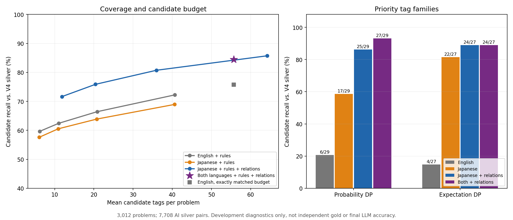

# 日本語定義・関連候補拡張の改善（2026-11-26）

**266タグの日本語定義と採否条件、286本の候補追加の関係を整備しました。** 全3,012問に適用し、旧候補を保持する方式で候補再現率が66.4%から84.4%になりました。既存のV4タグ・階層クラスタリングは変更していません。

[266タグの定義・採否条件を読む](tag_definitions_ja.md) / [関連候補の一覧CSV](relations.csv) / [比較図](bilingual_output/comparison.png) / [以前の試作](../README.md)

## 比較結果

候補再現率は、既存V4の問題×タグ7,708組のうち候補に残った割合です。**V4はAIレビュー由来のsilverラベルで、人手の正解集合ではありません。最終タグの正解率・適合率・F1でもありません。**

| 方式 | 平均候補数 / 266 | 候補再現率 | 確率DPが残る件数 | 期待値DPが残る件数 |
|---|---:|---:|---:|---:|
| 旧英語定義 上位20＋ルール | 20.8 | 66.4% | 6 / 29 | 4 / 27 |
| 日本語定義 上位20＋ルール | 20.8 | 63.9% | 17 / 29 | 22 / 27 |
| 日本語定義＋ルール＋関連候補 | 36.0 | 80.7% | 25 / 29 | 24 / 27 |
| **旧候補を保持＋日本語候補＋関連候補** | **55.7** | **84.4%** | **27 / 29** | **24 / 27** |

日本語化だけでは全体の再現率は下がりました。定義の具体化は確率系に有効でしたが、旧版で拾えていたタグを失う例もあります。そのため、**既存候補を保持する最後の方式を、次のAI判定へ渡す入力として用意しています。** 36候補の方式も、候補数を抑える比較案として保存しました。

最終方式は、旧英語の候補と日本語版の拡張後候補の両方を全3,012問で包含します。旧方式で残っていた5,121組を失わず、1,387組が追加で残り、6,508 / 7,708組となりました。全参照タグが残る問題は、タグがある2,692問中1,700問（63.2%）です。候補数は平均55.7、95パーセンタイル65、最大73。全266候補より平均79.1%少ないですが、旧方式の約21候補より負担は増えます。



[PNG](bilingual_output/comparison.png) / [SVG](bilingual_output/comparison.svg) / [日本語版の全条件](output/candidate_metrics.csv) / [旧候補保持版の全条件](bilingual_output/candidate_metrics.csv)

### 同じ候補数でも改善したか

問題ごとに候補数を最終方式と**完全に同じ**にした対照条件も作りました。平均が同じだけの比較ではありません。

| 同じ候補数での作り方 | 候補再現率 |
|---|---:|
| 英語の検索順位を広げる＋ルール | 75.8% |
| 日本語の検索順位を広げる＋ルール | 72.2% |
| 英語と日本語の順位を交互に広げる＋ルール | 74.9% |
| 旧候補保持＋日本語候補＋関連候補 | **84.4%** |

同じ予算の英語対照に比べ、参照タグ900組を拾い、233組を失い、差引667組が多く残りました。関連候補による改善は、単純な候補数の増加だけでは説明できない結果です。ただし、これは同一データでの開発実験であり、未見問題への性能保証ではありません。

## ルールを具体的にどう変えたか

検索に埋め込む文章は、手法の操作・状態・構造を説明する**肯定的な日本語定義**だけです。採用条件と除外条件はAIの判定入力に分けて渡します。「使わない」と書いた手法が埋め込み検索で近くなる混乱を避けるためです。

| タグ | 採用時に確認すること | 混同しないこと |
|---|---|---|
| 確率DP | 状態値が到達確率・成功確率で、確率質量を配る/集める具体的遷移がある | サイコロや確率が出るだけでは採用しない。期待値だけの状態とも区別 |
| 期待値DP | 状態値が残り手数・費用等の期待値で、遷移先の期待値を重み付けする | 期待値の直接公式だけではDPにしない |
| BFS | 距離の層順に探索する | DFSとの類似性で同一視しない |
| DFS | 一枝を深く進み、戻って次の枝へ進む | 単なる再帰やBFSをDFSと呼ばない |
| 数え上げ | 条件付きの選択・配置・順序等の個数を数える | 入力数値の単純な総和を自動的に付けない |
| 乱択 | アルゴリズム自身が乱数を使う | 確率的な問題設定や決定的な確率DPだけでは付けない |

共通方針は従来どおり、**主解・全制約で実行可能な具体的別解・実際の補助手法**を含めます。証明上の言及、参考題名、未使用ライブラリ、部分点や速度不足だけの解法は採用しません。別解は状態・遷移・計算量を示して確認する方針です。

編集元は[definitions_ja.tsv](definitions_ja.tsv)と[policy.py](policy.py)。読みやすい[全266件の一覧](tag_definitions_ja.md)も生成しました。

### 関連候補の3種類

- `parent`（上位概念）：疎グラフDijkstra → Dijkstra → 最短経路、桁DP → 基礎DP。上位関係だけは推移的にたどります。
- `support`（補助手法の候補）：BFS → Queue、確率DP → 基礎DP、法上の確率計算 → モジュラ逆元。実際の採用は実装・遷移で確認します。
- `possible_variant`（別解候補）：確率過程のDP → 確率DP/期待値DP、部分集合や順序の全探索 → bit DP。別解が成立する保証ではなく、検証対象の追加です。

補助・別解候補のリンクは**最初の候補から1段だけ**に限定します。その先で補助や別解を無制限に連鎖させません。確率過程、法、数え上げ、部分集合や順序などの条件は、V4ラベルを参照せず対象の問題文・範囲を絞った解説で確認します。各追加候補には、元タグ・関係ID・条件の該当箇所・経路を保存しています。

**どの関係も最終タグの自動付与ではありません。** BFSとDFSを統合する関係は設けておらず、両者の定義と採用条件は別です。検索で両方が候補に入っても、適切な方を判定する必要があります。

[関係の編集元](relations.tsv) / [日本語ラベル付きの一覧](relations.csv) / [機械用の関係JSON](bilingual_output/relations.json)

## AI判定と残っている課題

最終方式で全3,012問のAI入力と[代表20問の入力](bilingual_output/pilot_requests_scoped.jsonl)を作りました。[共通API実行器](../run_with_fallback.py)は実験ディレクトリを指定でき、候補不足時の全266タグへの再判定でも日本語定義を維持します。

**外部LLM APIによる全件判定は未実施で、呼び出しは0回です。** この会話のAIによる[3件の判定例](bilingual_output/session_examples.jsonl)を作り、BFSと最短路の区別、ABC263 Eの期待値DP/確率DP別解、ABC319 Cの全探索/集合確率DP別解を確認しました。指定した解法の例であり、独立した精度評価ではありません。他の全別解を監査した完了判定にもしていません。

ABC319 Cでは、日本語だけの案で落ちた全探索を旧候補保持で回復し、bit DP・確率DPも関連候補に残せました。集合DP別解の整数版は以前に4盤面で9!通りの全順列の計数と照合済みです。

既存V4にあるタグ1,200組はなお候補に残りません。確率系で残る漏れは次の5件です。[問題URL・役割付きCSV](bilingual_output/priority_remaining_misses.csv)から確認できます。

| タグ | 残る問題 | V4上の役割 |
|---|---|---|
| 期待値DP | ABC145 C Average Length | 別解 |
| 期待値DP | ABC199 F Graph Smoothing | 補助 |
| 期待値DP | ABC224 F Problem where +s Separate Digits | 別解 |
| 確率DP | ABC345 G Sugoroku 5 | 補助 |
| 確率DP | ABC439 G Sugoroku 6 | 補助 |

候補の増加に伴い、不適切な仮説もAIへ渡ります。たとえば確率DPは248問に提示しますが、V4の該当29件中27件が含まれる、という意味です。**確率DPを248問へ付与したわけではありません。** 候補の再現率と最終採用の適合率は分けて評価する必要があります。

## 評価の限界と再現条件

- 以前と同じ本文19,814窓のベクトル、モデル、接頭辞、ルール候補を再利用しました。変えたのはタグの定義文と候補選択です。日本語定義の最長入力は97トークンで切り捨ては0件。
- 日本語化と説明の具体化を同時に行ったため、言語だけの因果効果を測る実験ではありません。
- 日本語版の評価後に候補の脱落を確認し、旧候補保持版を追加しました。両段階の設定hashと結果を分けて保存しています。後者は診断を踏まえた開発上の改善で、未使用のテスト集合ではありません。
- 既存V4自体も独立した人手正解ではありません。最終的な適合率・再現率・F1、候補不足の検出率、保留率、料金・速度は測れていません。
- 以前の本文範囲切り出しの限界は残ります。AI入力には追加のPDF見出しガードを適用していますが、そのガードで全本文ベクトルを再作成した比較ではありません。

[日本語版の設定・生成記録](output/generation_summary.json) / [旧候補保持版の設定・生成記録](bilingual_output/generation_summary.json) / [評価記録](bilingual_output/silver_evaluation.json) / [全タグ別](bilingual_output/tag_metrics.csv) / [残る漏れ全件](bilingual_output/candidate_misses.csv)

## 再実行

リポジトリのルートで実行します。以前の試作のモデル・本文ベクトルと、範囲処理済み入力が必要です。前提の生成手順は[以前のREADME](../README.md#再実行)を参照してください。

```powershell
$py = '.\.venv-clustering\Scripts\python.exe'
& $py -X utf8 abc_all\retrieval_trial\japanese_v2\generate.py
& $py -X utf8 abc_all\retrieval_trial\japanese_v2\evaluate.py
& $py -X utf8 abc_all\retrieval_trial\japanese_v2\bilingual.py
& $py -X utf8 abc_all\retrieval_trial\japanese_v2\evaluate_bilingual.py
& $py -X utf8 abc_all\retrieval_trial\japanese_v2\review_examples.py
& $py -X utf8 abc_all\retrieval_trial\japanese_v2\report.py
& $py -X utf8 abc_all\retrieval_trial\japanese_v2\verify.py
```

次のAPI判定は`bilingual_output`を指定します。`--dry-run`中は外部送信しません。

```powershell
& $py -X utf8 abc_all\retrieval_trial\run_with_fallback.py --experiment-dir abc_all\retrieval_trial\japanese_v2\bilingual_output --pilot --base-url "$env:TAGGER_BASE_URL" --model "$env:TAGGER_MODEL" --api-key-env TAGGER_API_KEY --output-dir abc_all\retrieval_trial\cache\bilingual_api_pilot --dry-run
```

[整合検査](bilingual_output/verification.json)では、266定義・286関係、上位関係の閉路なし、任意関係の連鎖抑止、全3,012問で旧候補を保持すること、追加理由103,733経路、17問でのスコア再計算、全3,012問の範囲付き入力、3例の原文引用、V4未変更を確認しました。APIの候補不足時の処理は模擬応答による契約テストと、実入力のdry runで検査しています。
