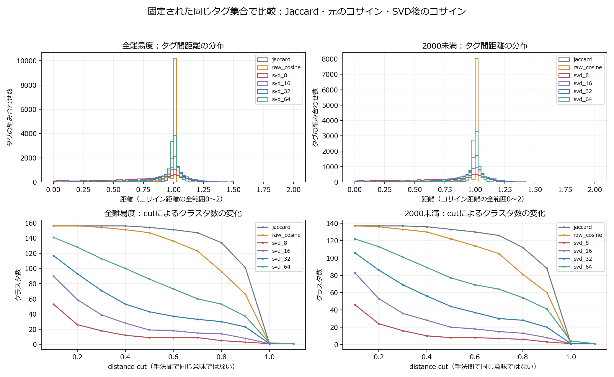

# 問題・タグ対応行列のSVD実験

実験日：2026-11-12 / 入力スナップショット：2026-11-05 / 外部AI API：0回・追加費用0円

## 結果の要点

**SVD後は直接の共起がないタグにも異なる距離が付き、低いcutでまとまりやすくなった。一方、学習単位として混在が疑われる群も残り、今回の結果だけでタグの粒度がそろったとは判断できない。**

- 8・16・32・64次元を比較した。32次元は結果を見る前に選んだ表示例で、最適な次元数ではない。
- 32次元・cut=0.7では全難易度33群、2000未満30群。共起情報がない「文字列処理」は、それぞれ別枠で1タグ残る。
- シルエット係数はそれぞれ0.529、0.485。ただし距離空間とクラスタ数が変わっているため、旧数値との差を分類精度の向上とは解釈しない。
- 全難易度では「最小全域木・Kruskal・Prim」が同じ群になった。一方「連分数・Bellman-Ford・Stern-Brocot」など、統合の妥当性を確認する必要がある群もできた。
- 次元数や問題の抽出によって結果が変化する。独立した人による意味的な正解ラベルの評価は未実施。
- 元のデータとJaccard版の結果、AtCompassの表示は変更していない。

## 1. 同じ入力で比較

タグ付与をやり直さず、以前の全難易度・2000未満の比較に使った行列を固定して利用した。タグ名・問題文・解説文は特徴量に使わず、問題とタグの0/1対応だけを入力した。

| 対象 | 問題数 | 元の使用タグ数 | 比較するタグ数 | 別枠の使用タグ | 未使用タグ |
|---|---:|---:|---:|---|---:|
| 全難易度 | 3,012 | 157 | 156 | 文字列処理1種類 | 109 |
| 2000未満 | 2,473 | 139 | 138 | 文字列処理1種類 | 127 |

「文字列処理」は全難易度167問・2000未満162問に付くが、他のどのタグとも同一問題に付いていない。初期のSVD確認では8・16・32次元で潜在ベクトルが数値的にほぼゼロになった。ゼロベクトルのコサイン距離を便宜的に作らず、この実験では全手法から共通に除外し、別枠として明示した。未使用タグも行列だけでは学べないため、理由付きで [全難易度](all_difficulties/excluded_tags.csv)・[2000未満](under_2000/excluded_tags.csv) に記録した。

このため、以下のJaccard再計算は156／138タグが対象である。以前の157／139タグ・cut=0.7の148／127群とは対象タグ数が1つずつ異なり、この再計算では147／126群になる。

## 2. 計算方法

1. 元の「問題×タグ」行列を「タグ×問題」に転置する。
2. 各タグの行をL2正規化する。出現頻度による行の長さの違いを取り除く。この重み付けは設計上の選択であり、希少タグの影響にも注意する。
3. 平均を引かず、厳密な薄いSVDで A = UΣVᵀ に分解する。乱数を使う近似SVDは使わない。
4. 上位k成分からタグベクトル Y = UₖΣₖ を作る。kは8・16・32・64。
5. タグ間距離を 1 − コサイン類似度 とし、平均連結法で階層クラスタリングする。
6. cutを0.1〜1.0で0.1刻み、さらに1.1・1.25・1.5・2.0で確認する。

比較対象はJaccard距離と圧縮前のコサイン距離。圧縮前のコサイン距離では、共通問題がないタグ間の距離は引き続き1になる。SVDは、その圧縮によって全体の対応パターンを近似する。

**SVD後のコサイン距離は0〜2を取り得る。1を超える値は誤りではなく、負のコサイン類似度に対応する。値を1で打ち切っていない。** 同じcut=0.7でもJaccard版とSVD版で意味は異なる。

## 3. cut=0.7での比較

数値は各手法自身の距離空間で計算した。

| 対象 | 手法 | 群数 | シルエット | コーフェネティック相関 | 特異値二乗和の保持率 |
|---|---|---:|---:|---:|---:|
| 全難易度 | Jaccard | 147 | 0.035 | 0.863 | — |
| 全難易度 | 元のコサイン | 123 | 0.107 | 0.784 | 100.0% |
| 全難易度 | SVD 8 | 9 | 0.568 | 0.711 | 13.1% |
| 全難易度 | SVD 16 | 15 | 0.498 | 0.688 | 22.4% |
| 全難易度 | SVD 32 | 33 | 0.529 | 0.697 | 37.9% |
| 全難易度 | SVD 64 | 60 | 0.449 | 0.713 | 61.2% |
| 2000未満 | Jaccard | 126 | 0.064 | 0.890 | — |
| 2000未満 | 元のコサイン | 105 | 0.154 | 0.796 | 100.0% |
| 2000未満 | SVD 8 | 7 | 0.521 | 0.723 | 15.2% |
| 2000未満 | SVD 16 | 15 | 0.473 | 0.697 | 26.0% |
| 2000未満 | SVD 32 | 30 | 0.485 | 0.694 | 43.3% |
| 2000未満 | SVD 64 | 64 | 0.463 | 0.737 | 68.6% |

保持率は非中心化行列の特異値二乗和の比であり、意味の正確さや通常の中心化PCAの分散説明率ではない。シルエット係数の上昇には、表現空間の変化・圧縮による距離の変化・単独タグ群の減少が含まれる。

クラスタ数の違いによる影響を確認するため、各対象のJaccard cut=0.9の群数（全難易度101群、2000未満88群）に合わせた比較も行った。全手法で群数を正確に一致させられた。ただし距離空間の違いは残るため、ここでもシルエットを分類精度とはみなさない。詳細：[全難易度](all_difficulties/matched_cluster_counts.csv)・[2000未満](under_2000/matched_cluster_counts.csv)。

## 4. デンドログラムとクラスタ内訳（32次元）

図の配置を修正し、タグ名を左側、結合を右側にした。各タグのすぐ右から枝が始まり、横軸は左の0から右へ距離が大きくなる。タグ順序・クラスタ所属・距離・指標は変更していない。

| 対象 | cut | 群数（別枠を除く） | PNG | SVG | 内訳CSV | 群一覧 |
|---|---:|---:|---|---|---|---|
| 全難易度 | 0.7 | 33 | [画像](all_difficulties/svd_32/dendrogram_cut_0.7.png) | [拡大用](all_difficulties/svd_32/dendrogram_cut_0.7.svg) | [CSV](all_difficulties/svd_32/cluster_members_cut_0.7.csv) | [一覧](all_difficulties/svd_32/clusters_cut_0.7.md) |
| 全難易度 | 0.8 | 30 | [画像](all_difficulties/svd_32/dendrogram_cut_0.8.png) | [拡大用](all_difficulties/svd_32/dendrogram_cut_0.8.svg) | [CSV](all_difficulties/svd_32/cluster_members_cut_0.8.csv) | [一覧](all_difficulties/svd_32/clusters_cut_0.8.md) |
| 全難易度 | 0.9 | 23 | [画像](all_difficulties/svd_32/dendrogram_cut_0.9.png) | [拡大用](all_difficulties/svd_32/dendrogram_cut_0.9.svg) | [CSV](all_difficulties/svd_32/cluster_members_cut_0.9.csv) | [一覧](all_difficulties/svd_32/clusters_cut_0.9.md) |
| 2000未満 | 0.7 | 30 | [画像](under_2000/svd_32/dendrogram_cut_0.7.png) | [拡大用](under_2000/svd_32/dendrogram_cut_0.7.svg) | [CSV](under_2000/svd_32/cluster_members_cut_0.7.csv) | [一覧](under_2000/svd_32/clusters_cut_0.7.md) |
| 2000未満 | 0.8 | 28 | [画像](under_2000/svd_32/dendrogram_cut_0.8.png) | [拡大用](under_2000/svd_32/dendrogram_cut_0.8.svg) | [CSV](under_2000/svd_32/cluster_members_cut_0.8.csv) | [一覧](under_2000/svd_32/clusters_cut_0.8.md) |
| 2000未満 | 0.9 | 20 | [画像](under_2000/svd_32/dendrogram_cut_0.9.png) | [拡大用](under_2000/svd_32/dendrogram_cut_0.9.svg) | [CSV](under_2000/svd_32/cluster_members_cut_0.9.csv) | [一覧](under_2000/svd_32/clusters_cut_0.9.md) |

同じ対象・次元数ではcutを変えても樹形は同じで、カット位置と枝色が変わる。枝色は繰り返されるため、色だけで分野を識別しない。

## 5. 具体例で確認できたこと

全難易度・32次元・cut=0.7では、以下が同じ群になった。後半の例は、同一の学習単位としてまとめてよいか特に確認したい群である。

- 最小全域木、Kruskal法、Prim法。
- 最大流、最小カット、燃やす埋める、Dinic法、Ford-Fulkerson／Edmonds-Karp。
- 連分数、Bellman-Ford法、Stern-Brocot Tree／Farey列。
- Map／連想配列、Trie、Aho-Corasick、離散対数。
- 後退解析、Suffix Automaton。

直接共起がない2-SAT・閉路検出・木の塗り分けが、SVD後は数値的にほぼ距離0になった。情報を圧縮すると異なる元のベクトルが同方向へ投影され得る。距離0でも同義・同じ粒度と確認されたわけではない。

同じタグペアでも次元数で距離が変わる。全難易度の「二部マッチング・辺彩色」は32次元で約0.072、64次元で約0.937。2000未満の「Bellman-Ford・Dijkstra」は32次元で約0.174、64次元で約0.969だった。

固定して確認した [タグペアの比較](example_pairs.csv)、[共通問題なしで近くなった組：全難易度](all_difficulties/newly_close_without_overlap.csv)、[同：2000未満](under_2000/newly_close_without_overlap.csv) を保存した。これらは探索的な確認用であり、独立した正解データではない。

## 6. 距離分布と安定性



32次元では、距離が1ちょうどの組は数値許容差1e-10で0件になった。しかし中央値は両対象とも約0.995で、1付近への集中は残る。約46%の組は距離1より大きい。「距離1の同率を分けられた」ことと「遠いタグ間の意味的な違いを正しく捉えた」ことは分けて評価する。

次元数の変更でcut=0.7の群数は、全難易度9／15／33／60群、2000未満7／15／30／64群と変わった。次元数を下げて群数が減ること自体は、粒度がそろった証拠ではない。詳細：[次元数による変化](dimension_sensitivity.csv)。

問題を80%だけ残す非復元抽出をseed 0〜4で5回行い、残った共通タグ上で近傍5タグの一致率を比較した。

| 対象 | 手法 | 近傍5タグの平均一致率 | 全タグペア距離の平均Spearman相関 |
|---|---|---:|---:|
| 全難易度 | jaccard | 86.8% | 0.943 |
| 全難易度 | raw_cosine | 86.1% | 0.944 |
| 全難易度 | svd_32 | 77.3% | 0.717 |
| 2000未満 | jaccard | 86.6% | 0.938 |
| 2000未満 | raw_cosine | 85.7% | 0.939 |
| 2000未満 | svd_32 | 73.9% | 0.678 |

今回の範囲ではSVD32の近傍はJaccardより問題の抽出に敏感だった。ただし少数の試行であり、正解率の比較ではない。Jaccard・元のコサインでは同率距離が多く、近傍の同率はタグID順で決めているため、その影響もある。出現がなくなったタグと潜在ベクトルがほぼゼロになったタグは、全手法共通の比較から除外した。詳細：[抽出による安定性](subsample_stability.csv)。

## 7. 採用判断と次の検証

現時点ではSVDは比較候補として有用だが、粒度統一の方法としての採用は保留する。直接共起のないタグを区別するという計算上の変化は確認できた。一方、異なる技法の混在・次元数への依存・問題抽出への感度がある。

次は [人手レビュー用のタグペア](review_pairs.csv) と [固定例](example_pairs.csv) について、同義・同系統・親子・共用・無関係などの関係と「同じ学習単位としてまとめてよいか」を確認する。候補例には今回の出力を見て選んだ探索的な例も含むため、正式な評価では別に固定した評価例を用意する。

元の問題タグ付与には未判定や誤付与の可能性があり、その影響はSVDにも残る。行列の0を適用不能の正解ラベルとはみなしていない。未使用タグを復元できた、全タグの意味的な関係を学べた、という結論は出していない。

## 8. 検証と再実行

入力ハッシュの一致、元行列のSVD再構成、全成分でのコサイン距離一致、固有値による特異値の独立照合、全タグペアの距離・共起数、クラスタ所属・問題数、評価指標、PNG・SVGの整合性を確認した。結果：[verification.json](verification.json)。

リポジトリ直下から実行する。以下は計算データと画像を再生成するコマンドで、この解釈文とMarkdown群一覧は実行後に作成した共有用資料である。

```powershell
.\.venv-clustering\Scripts\python.exe -X utf8 abc_all\svd_experiment.py
.\.venv-clustering\Scripts\python.exe -X utf8 abc_all\verify_svd_experiment.py
```

外部API・新規のモデルダウンロードは不要。既存のrequirements-clustering.txtの環境を使う。出力はこの実験フォルダーに保存する。

- [全パラメータの結果](parameter_sweep.csv)
- [全難易度の全タグペア距離](all_difficulties/pair_distances.csv)
- [2000未満の全タグペア距離](under_2000/pair_distances.csv)
- [全難易度の近傍一覧](all_difficulties/nearest_neighbors.csv)
- [2000未満の近傍一覧](under_2000/nearest_neighbors.csv)
- [条件・バージョン・入力ハッシュ・集計JSON](summary.json)

参考：[SciPy SVD](https://docs.scipy.org/doc/scipy/reference/generated/scipy.linalg.svd.html)、[コサイン距離](https://docs.scipy.org/doc/scipy/reference/generated/scipy.spatial.distance.cosine.html)。
