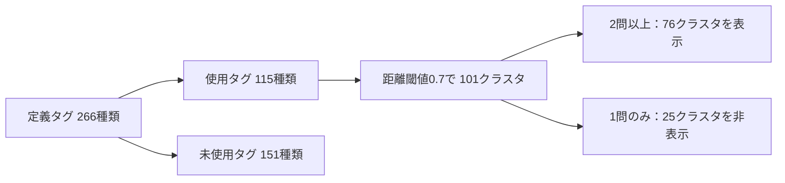

# AtCompass：アルゴリズムタグの階層クラスタリングの課題と改善方針

作成日：2026-10-29  
対象：距離閾値（distance cut）0.7版  
データバージョン：`hc101-jaccard-average-d0.7-v1`  
ステータス：現状整理・改善方針の提案（統合・分割の判断は未確定）

## まず共有したいこと

現在の階層クラスタリングは、**同じ問題に付与されやすいタグをまとめる手法**である。この結果だけでは、アルゴリズムの分類粒度や学習範囲が統一されたとは判断できない。

現行版では、使用された細粒度タグ115種類から101クラスタを生成し、2問以上に対応する76クラスタをAtCompassの表示対象としている。まず、表示対象のうち複数タグを含む8クラスタについて、同じ学習単位として扱ってよいかを確認したい。

提案する方針は、**階層クラスタリングを関連タグの候補発見に使い、意味的関係と学習単位の判断を追加すること**である。

## 1. 背景と目的

元のアルゴリズム分類には、「DP」のような広い概念と、「木DP」「確率DP」のような具体的な手法が混在している。これらをそのまま並べると、可視化上の各タグが表す範囲を比較しにくい。

そこで、細かく分けたタグを問題に付与し、問題集合の類似性に基づいて階層クラスタリングを行った。最終的には、AtCompassで学習状況を比較・可視化し、学習順序の検討にも利用できる分類を目指している。

当初のフィードバックには「問題とアルゴリズムの関連度・最適度をスコア化する」という案もあった。ただし、**現行の入力はタグの付与有無を表す0/1データであり、解法としての最適度を評価したスコアではない。**

## 2. 現行版のデータと表示範囲

### 用語の区別

- **細粒度タグ**：`tags.md`をもとにした元の分類項目。
- **クラスタ**：階層クラスタリングでまとめたグループ。元のタグが1種類だけのグループも含む。
- **表示分類**：AtCompassの表示条件を満たしたクラスタ。現行条件は「対応問題数が2問以上」。

### 現行の集計値

| 項目 | 数値・条件 |
| --- | ---: |
| 対象問題数（問題IDの重複を除く） | 898問 |
| 定義された細粒度タグ | 266種類 |
| 問題に付与された細粒度タグ | 115種類 |
| 未使用の細粒度タグ | 151種類 |
| 問題と細粒度タグの対応 | 1,740組 |
| 対応問題が1〜2問の細粒度タグ | 48種類 |
| 距離閾値 | 0.7 |
| 生成されたクラスタ | 101個（複数タグ11個・単独タグ90個） |
| 問題とクラスタの対応 | 1,720組 |
| 画面の表示分類 | 76個（複数タグ8個・単独タグ68個） |
| 1問のみのため非表示となるクラスタ | 25個 |



**「101クラスタ」と「76分類」は集計対象が異なる。** 非表示条件は画面への出し方を変えるものであり、クラスタリングの入力や結合結果を再計算するものではない。

同じ問題に付いている複数タグが一つのクラスタになるため、問題・細粒度タグの1,740組と、問題・クラスタの1,720組も異なる。クラスタの対応問題数は、メンバータグの問題数の単純合計ではなく、問題IDの重複を除いた件数である。

### 問題のカバー範囲

データ全体には898問が存在する。一方、表示条件を適用した76分類のいずれかに含まれる問題は**896問（約99.8%）**である。

`abc266_c`、`abc398_f`の2問は、対応先がすべて非表示クラスタとなるため、表示分類からは参照されない。表示対象だけで全898問をカバーしているとは扱わない。

また、898問は今回の分析対象内の件数であり、AtCoder全体の問題を網羅していることを意味しない。

### 元資料との数値の違い

元の問題提起資料にある「使用104タグ・未使用162タグ・距離閾値0.9で70クラスタ」は、検証前のデータによる結果である。現行の0.7版とは区別して扱う。

| 項目 | 元資料の検証前0.9版 | 現行の修正後0.7版 |
| --- | ---: | ---: |
| 使用した細粒度タグ | 104 | 115 |
| 問題と細粒度タグの対応 | 1,720 | 1,740 |
| クラスタ数 | 70 | 101 |
| シルエット係数 | 0.0835 | 0.1366 |
| Cophenetic Correlation | 0.9194 | 0.9669 |

入力データと距離閾値の両方が異なるため、この比較から閾値変更だけの効果は判断できない。元資料の1,720組と現行の問題・クラスタ1,720組は、偶然同じ件数になっているが、対応の意味が異なる。

## 3. 現在の方法で測っているもの

タグAが付いた問題集合をP(A)、タグBが付いた問題集合をP(B)として、Jaccard類似度と距離を求める。

```math
J(A,B)=\frac{|P(A)\cap P(B)|}{|P(A)\cup P(B)|},\qquad d(A,B)=1-J(A,B)
```

同じ問題への付与が重なるほど、距離は小さくなる。この距離に平均連結法（Average Linkage / UPGMA）を適用する。平均連結法では、二つのクラスタにまたがるタグの組の距離を平均し、結合する順序を決める。

距離閾値0.7は、階層のどこでグループを切るかという設定である。**「同じクラスタのすべてのタグ対の距離が0.7以下」「意味が70%一致する」という条件ではない。**

現在の0/1行列から分かるのは、どの問題にどのタグが付与されたかである。0は「未付与」を表し、その解法が適用不可能であることを保証しない。

## 4. 残っている問題点

### 4.1 同じ問題に現れることと、同じ学習単位であることが区別されない

タグが同じ問題に現れる理由には、同義語、同時使用、別解、上位・下位概念などがある。現在の距離では、これらが同じ「問題集合の重なり」として扱われる。

例えば現行のC043には「重心分解・畳み込み・FFT」が含まれる。この結合については、同じ学習単位なのか、組み合わせて使われたため近くなったのかを確認する必要がある。タグ名と共起だけで統合の妥当性は決められない。

### 4.2 タグ付け方針が、概念間の距離に影響する

広いタグを具体的なタグに置き換えると、上位・下位の概念でも共通問題が減る。例えば、具体的なDP手法を付けた問題から広いDPタグを外すと、概念的な近さが問題集合の重なりに反映されにくくなる。

したがって、今の行列から親子関係をそのまま復元することは難しい。上位カテゴリを分類情報として持つか、問題にも付与するかを別途決める必要がある。

### 4.3 異なる種類の関係を一つの階層に押し込めている

分類には、アルゴリズム、データ構造、数学的概念、解くべき問題の種類などが含まれている。データ構造を独立した学習単位として扱うこと自体は問題ではない。**「使用する関係」から「同じ単位」と判断してしまうことが問題となる。**

また、学習の前提関係は方向を持つ。問題の共起だけから、どちらを先に学ぶべきかは決められない。

### 4.4 少数の問題で決まる類似度が多い

115タグのうち48タグは、対応問題が1〜2問である。同じ1問にしか付いていない二つのタグは、意味が異なっていてもJaccard類似度が1になる。

「1問のクラスタを非表示にする」対応は画面を整理する効果があるが、2問以上のクラスタにも少数データの影響は残る。未使用の151タグには問題集合の情報がなく、現行の方法で分類位置を決めることもできない。

### 4.5 主解・別解・補助という役割の確認が十分ではない

一部の対応には検証状態や役割の情報が付いているが、全件を確認した状態ではない。

| 対応データの検証状態 | 件数 |
| --- | ---: |
| 未レビュー（not_reviewed） | 1,651 |
| 追加を支持（add_supported） | 22 |
| 既存付与を支持（supported_existing） | 61 |
| 要再確認（needs_review） | 6 |
| 合計 | 1,740 |

この状態名は現在の記録を示すもので、独立した人による全件検証の完了を意味しない。また、クラスタリングの0/1入力には、主解・別解・補助の違いが反映されていない。

## 5. 最初に確認したい8クラスタ

現在表示されている複数タグクラスタを、最初のレビュー対象とする。以下の「確認点」は検証の観点であり、**誤結合や分割を確定した判定ではない。**

| ID | 含まれる細粒度タグ | 対応問題数 | 確認したい点 |
| --- | --- | ---: | --- |
| C032 | Grundy数 / Sprague-Grundy、Nim | 2 | 学習範囲を同じ単元にまとめてよいか。2問の重なりだけで判断していないか。 |
| C033 | ミニマックス法、後退解析 | 6 | 考え方・適用条件・解く手順を比較したとき、一つの学習単位になるか。 |
| C039 | トポロジカルソート、閉路検出 | 6 | 手法と判定目的の関係か。同じ問題で使えることを同一性と扱っていないか。 |
| C043 | 重心分解、畳み込み、FFT | 2 | 組み合わせて使う関係と、処理・実装手法の関係を分けて確認できるか。 |
| C052 | Suffix Array、Z-Algorithm、Rolling Hash | 5 | 共通の用途だけで統合していないか。適用条件や実装の違いをどう扱うか。 |
| C058 | 乱択アルゴリズム、Color Coding | 2 | 広い考え方と具体的手法の粒度がそろっているか。 |
| C081 | 2-SAT、二部グラフ判定 | 3 | 特定の問題で代替できることと、同じ学習単位であることを区別できるか。 |
| C088 | 拡張 Euclid の互除法、線形合同方程式 | 3 | 解くための手法と、解く対象となる問題の種類の関係ではないか。 |

クラスタ名の代表タグだけでは内容を把握しにくいため、レビュー時にはメンバータグと代表問題を併記する。クラスタIDは本記事のデータバージョン内の識別子であり、閾値や入力を変更した後の比較には元のタグIDも利用する。

## 6. 改善方針の提案

### 6.1 「一つの学習単位」の判断基準を決める

基準案は、「対象とする学習者が、基本的な考え方・適用条件・典型実装を一つの単元として学べる範囲」とする。実際の判定では、次の情報をそろえる。

| 項目 | 記録する内容 |
| --- | --- |
| 対象学習者 | 想定する知識・経験 |
| 単位の目的 | 何ができるようになるか |
| 適用条件 | どのような入力・問題に使えるか |
| 中心的な内容 | 考え方、主要操作、典型実装 |
| 前提知識 | 先に必要になる知識と理由 |
| 範囲の境界 | 含める内容と、別単位として扱う内容 |
| 代表問題 | 判断を確認できる問題と解説 |

階層の深さが同じでも、学習負荷が同じになるとは限らない。何をそろえるのかをチームで決めてから、統合・分割を判断する。

### 6.2 タグ間の意味的関係を分けて記録する

| 関係 | 意味 | 扱い方の案 |
| --- | --- | --- |
| same-as | 同義・別名 | 名前を正規化する。例：BITとFenwick Tree。 |
| is-a | 上位・下位概念 | 概念の階層として保持し、統合するかは別に判断する。 |
| uses | ある手法が別の手法・構造を利用する | 使用条件を付けて記録する。 |
| alternative | 条件によって同じ問題の別解になる | 対象問題・適用条件を付けて記録する。 |
| prerequisite | 学習上の前提になる | 方向と根拠を記録する。 |

関係は一つに限定せず、条件付きで複数持てるようにする。上位・下位関係だけを扱う部分ではDAGも候補になるが、代替関係や同義関係を含む全関係を、一つの木やDAGに無理に統一しない。

### 6.3 クラスタリングは候補の抽出に使う

1. 現行の8クラスタを起点に、関連するタグ対と代表問題を取り出す。
2. 問題文・解説を確認し、主解・別解・補助の役割とタグ間の関係を記録する。
3. 学習単位の基準に照らし、「統合を維持」「分割」「保留」を判断する。
4. 判断理由を残し、問題へのタグ付けと可視化データを更新する。
5. 人手評価と安定性の確認を行う。

LLMは候補や判断理由の下書きに利用できるが、LLM自身の出力だけを正解として妥当性を評価しない。可能であれば2名が独立に判定し、不一致の理由を確認する。

8クラスタの確認は初期調査と位置付ける。クラスタにまとめられなかった単独タグにも親子関係・別名・タグ付け漏れがあり得るため、全体の粒度統一が完了したとは扱わない。

## 7. 評価をどう追加するか

現行モデルのシルエット係数は0.1366、Cophenetic Correlationは0.9669である。これらは**115個の細粒度タグを対象とした101クラスタのモデル**に対する値であり、表示された76分類だけを評価した値ではない。

シルエット係数は設定した距離に基づく分離を、Cophenetic Correlationは元の距離と階層上の結合距離の対応を評価する。単独タグのクラスタが多いことにも留意する。どちらも、学習単位としての意味的な正しさを保証しない。

| 評価対象 | 確認方法の案 |
| --- | --- |
| タグ付けの正しさ | 問題・解説に基づき、付与の根拠と主解・別解・補助の役割を確認する。 |
| 統合の意味的一貫性 | 定義した学習単位の基準で複数人が判定し、一致率と不一致理由を記録する。 |
| 粒度の比較可能性 | 各単位の適用条件・実装範囲・前提知識を同じ様式で記述して比較する。 |
| 問題のカバー率 | データ全体と表示対象を分けて集計する。現状は898問／896問。 |
| 分類の安定性 | 問題集合の再標本化やタグ修正を行い、同じタグ対の結合が維持されるか確認する。 |
| 学習支援への有用性 | 利用者が学習状況を理解し、次に学ぶ内容を選びやすいかを評価する。 |

「数値が高くなったこと」「表示タグが減ったこと」だけをもって、粒度統一の成功とはしない。

## 8. チームで決めたいことと次の作業

### 議論したいこと

- [ ] 対象学習者と、「一つの学習単位」の判断基準を決める。
- [ ] データ構造・数学的概念も独立した学習単位に含めるか決める。
- [ ] 上位カテゴリと、問題に直接付与するタグをどう使い分けるか決める。
- [ ] 階層クラスタリングを関連候補の抽出に使う方針でよいか確認する。
- [ ] 8クラスタのレビュー担当と、不一致時の判断方法を決める。
- [ ] 1問のみの分類を非表示にする際、表示分類から外れる問題をどう扱うか決める。

### 作業の順序案

| 優先度 | 作業 | 成果物 |
| --- | --- | --- |
| 高 | 学習単位の基準を合意する | 判断基準と記入例 |
| 高 | 表示中の8クラスタをレビューする | 根拠付きの統合・分割・保留の記録 |
| 高 | 主解・別解・補助と意味的関係を記録する | 問題・タグ・関係のレビュー表 |
| 中 | 非表示の複数タグ3クラスタと単独タグを確認する | 表示条件に依存しない分類の点検記録 |
| 中 | 分類と可視化を更新して評価する | 更新データ、カバー率、安定性、人手評価の結果 |
| 継続 | 未使用タグに対応する問題を追加する | 対象範囲と追加理由を記録したデータ |

## 付録A：非表示の複数タグクラスタ

次の3クラスタは計算結果には含まれるが、対応問題が1問のため画面には表示されない。表示しないことで意味的な統合の問題が解決したわけではないため、後続レビューの対象に含める。

| ID | 含まれるタグ | 対応問題数 | 確認したい点 |
| --- | --- | ---: | --- |
| C018 | きたまさ法、Stars and Bars | 1 | 同じ1問に付いた別の考え方を、一つの学習単位として扱ってよいか。 |
| C031 | 二部マッチング、最大流 | 1 | 利用・帰着の関係と、学習単位の同一性を区別できるか。 |
| C035 | 凸包、線分交差判定、三角形の符号付き面積 | 1 | 同じ幾何問題への別の解き方を、統合してよいか。 |

## 付録B：レビュー記入テンプレート

クラスタ全体の判断に加え、必要に応じてタグ対ごとに複製して使用する。

| 項目 | 記入内容 |
| --- | --- |
| データバージョン・クラスタID |  |
| 対象のタグID・タグ名 |  |
| 確認した問題ID・解説URL |  |
| 各問題での役割（主解・別解・補助・未確定） |  |
| 関係候補（same-as / is-a / uses / alternative / prerequisite / その他） |  |
| 関係が成立する条件・方向 |  |
| 学習単位の基準に照らした判断理由 |  |
| 判定（統合を維持・分割・保留） |  |
| 判定者・確認日 |  |
| 他の判定者との不一致・未確認事項 |  |

## 付録C：集計元と再確認に使うファイル

本記事の現行値は、2026-10-29時点のローカル集計に基づく。

| ファイル | 確認できる内容 |
| --- | --- |
| `tags.md` | 元のタグ体系 |
| `validation/revised/all_problems_tagged.csv` | 細粒度タグの付与と検証状態 |
| `clustering_07/summary.json` | 条件、モデルの評価値、検証状態の集計 |
| `clustering_07/dataset_summary.json` | 現行データのバージョンと件数 |
| `clustering_07/cluster_catalog.json` | クラスタのメンバータグと対応問題数 |
| `clustering_07/all_problems_clustered.csv` | 問題とクラスタの対応 |
| `clustering_before_validation_20261022/summary.json` | 元資料の検証前0.9版の集計 |

AtCompass側の表示条件は、`src/utils/statistics.js`の`MIN_PROBLEMS_PER_TAG = 2`に基づく。
